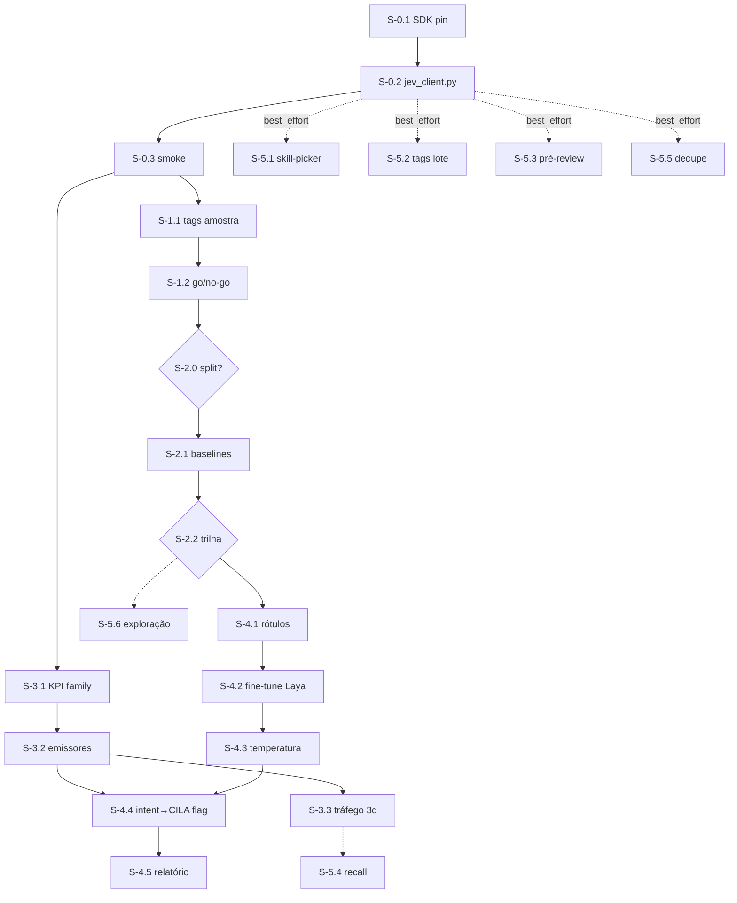

# Jev × Touring — execução W0–W5 (Pln2)

> **Level**: L3 (contém refactor em arquivo de blast_radius 46) | **Registry**: v30.4.87 → v30.5.x | **Scope**: 6 fases, 19 entregáveis atômicos
> **Status 01/10 13:30**: ✅ done — W0–W3 completas, S-4.1–4.4 (aluno treinado+integrado), S-5.1–5.4, S-5.6, S-5.7 · ⏳ S-4.5 (gate temporal: 7 dias de produção pós-flag) · 🔄 S-5.5 (touring-02, dedupe) · Propagação 30.4.89 em curso
> **Estratégia-mãe**: [strategy v3](/strategy-2026-09-30-jev-harness-potencializacao.md) (aprovada) · **Scan interno**: [harness-scan-t02](/harness-scan-t02.md) · **GT**: [data/ground_truth.json](/data/ground_truth.json)

## 1. Ground Truth Summary

- **e2e/health**: daemon 9/9 OK, CUDA ativo, índice gen 45 (5.409 arquivos, 94.804 símbolos) — `touring doctor -j` 30/09. Composite do status: 0,4682 [confidence: FACT — `touring status -j` no GT].
- **Chave**: `~/.config/typesafe/env` existe (27/09 16:28, 126 B, `TYPESAFE_API_KEY=`), **zero processos a carregam**; `typesafe-sdk` ausente; zero clientes no repo [confidence: FACT — harness-scan §1].
- **G0 ✅** (30.4.64: filtro `AUTOMATED_PAYLOAD_PREFIXES`, `crates/touring-hook-runtime/src/prompt_enhance.rs:379`) · **G1 ✅** (corpus 800 prompts + 486 memórias + 300 pares em `~/.claude/touring/g1-corpus/`; concordâncias 0,963/1,000/0,900; spot-check humano pendente) · **G2–G5 ⬜** [confidence: FACT — strategy v2 + scan §2].
- **Volumes 7d** [confidence: FACT — scan §3]: 1.340 prompts humanos (191/dia) · 2.250 memórias novas (321/dia) · recall SDK 35 (instrumento furado) · factory 10 tickets · tags erradas ≈ 34,6% × 19.815 ≈ 6.800.
- **Símbolos VGP** (30/09, `touring run --orchestrate` + `index_find`) [confidence: FACT]: `derive_tags` → `crates/touring-intelligence/src/rl/memory/tags.rs:147` · `deterministic_route` → `@companion/skills/Touring/scripts/factory.py:77` · `llm_route` → `factory.py:85` · `is_default_work` → `@companion/skills/loop-engineering/scripts/hooks/loop_outer_arm.py:117` · `AUTOMATED_PAYLOAD_PREFIXES` → `prompt_enhance.rs:379` · `compose_json` → `prompt_enhance.rs:433` · `classify_intent` → `crates/touring-server/src/server/tools_core.rs:256` · `_gather_clauses` → `@companion/skills/loop-engineering/scripts/loop_converged.py:661` · `sdk_signal_mirror` → `crates/touring-code/src/lib.rs:56` (referência; **não editar** — blast 186) · KPI families → `crates/touring-cli/src/cli/kpi.rs` (blast 5). **`derive_confidence` e `loop_converged` NÃO existem como símbolos — não citados.**
- **Blast medido** [confidence: FACT — `ast_blast` 01/10]: `prompt_enhance.rs` = **46** (edição = L3) · `kpi.rs` = **5** · `touring-code/src/lib.rs` = **186** (somente referência).
- **Docs oficiais 30/09** [confidence: FACT — docs.typesafe.ai]: endpoint `POST /v1/systemone`; modelo `jev-1.13.0`; 100K tok/s + 40 req/s; SDK `typesafe-sdk==0.7.2` (26/09, sem breaking desde 0.7.0; exige Python ≥ 3.10); 19 cookbooks.
- **Lições aplicadas** [confidence: FACT — GT memory_hits]: `instrumento-que-mente` (toda métrica nasce com prova de vida) · `kpi-fonte-declarada-sem-resolvedor` (W3 antes de W4) · `medir-volume-antes-de-priorizar` · `landlock-nega-mudo` (corpus lido fora do sandbox) · `daemon-herda-relaxação`.
- **Efeito é medido antes de afirmado** (regra 8): nenhuma fase promete número de economia; todo efeito passa por W2/G2 ou pelas métricas W3 [confidence: FACT — estrutura deste plano].

## 2. 9-Dimension Scores (auto-avaliação de autoria → alvo)

| Dim | Atual | Alvo | Amplificação aplicada (v1.2) |
|---|---|---|---|
| a Precision | 8 | 9 | símbolos com file:line VGP; os 2 não encontrados removidos |
| b Scalability | 8 | 9 | **registry pattern**: perguntas/thresholds num único módulo registrável (`jev_questions.py`); nova primitiva registra, não reescreve; KPI family é entrada de registro |
| c Performance | 7 | 9 | **tabela de orçamento por ponto** (abaixo); cache O(1) por hash; journal append O(1); batching de perguntas numa chamada (12,2× medido no cookbook) |
| d Functionality | 8 | 9 | W5 liga 4+ capacidades; **todo símbolo pub novo nasce com caller nomeado** (adapter ← W1/W2/W5; leitor de journal ← S-3.1) — REGRA #0 por construção |
| e Quality | 8 | 9 | todo entregável tem teste nomeado; fail-open em toda borda de rede |
| f Detail | 8 | 9 | schemas do journal/cache; edge cases (429/529, sem chave, sandbox, pt-BR) enumerados |
| g Integration | 8 | 9 | **mapa hook↔CLI por fase** (abaixo): quem emite (UserPromptSubmit, PreCompact, post_write), quem lê (`touring kpi`, `gate-metrics`), onde os journals vivem |
| h Dependencies | 8 | 9 | `typesafe-sdk==0.7.2` pin + hash · Python ≥ 3.10 · `system-one-adapter` pin por commit (MIT) · Laya pin por revisão · testes do hook-runtime exigem `--features pre-hooks,post-hooks` · zero deps novas no daemon |
| i Potentiation | 8 | 9 | matriz §6 + efeito composto: W3 serve qualquer modelo futuro; o contrato `/v1/systemone` serve qualquer fornecedor System One |

**Orçamento de latência por ponto de integração** (dim c):

| Ponto | Orçamento | Backend | Fundamento |
|---|---|---|---|
| hook síncrono (qualquer) | **proibido** enquanto S32b aberto | — | fila serial do daemon [confidence: FACT — scan §4.1] |
| fallback de qualquer rota | < 5 ms | código atual | não piora o caminho existente |
| aluno Laya (intent→CILA) | p99 < 30 ms | local RTX 4060 | medido 6–15 ms em 22/09 [FACT] |
| Jev em lote (W1/W2/W5.2) | 40 req/s, p99 < 1 s | API | rate limit oficial 30/09 [FACT] |
| recall rerank (W5.4) | ≤ +150 ms por recall | Jev ou aluno | recall p50 já < 50 ms [FACT — scan §3] |

**Mapa hook ↔ CLI** (dim g): `UserPromptSubmit` (prompt_enhance) → emite journal S-3.2 → lido por `touring kpi` (S-3.1) · `PreCompact` (loop_snapshot) → candidato S-5.6 · `post_write/post_edit` → codetags (existente) → W5.2 corrige em lote · `touring factory route` → ADW library → cada S-5.x · journal S-0.2 (`~/.claude/touring/logs/jev_journal.jsonl`) ← lido por S-3.1 e por `touring memory` (lições).

## 3. Phases

> Tickets: cada entregável vira subtask na DAG (`touring decompose`) com `--kind decision|implementation` e `--fog clear|hazy|unknown`; decisões abertas bloqueiam implementações dependentes (`decompose frontier`).

### Phase 0 — W0: LIGAR (0,5 dia) — pré-requisito de tudo

#### S-0.1: Instalar SDK pinado [P0] [confidence: FACT]
- **File**: ambiente (nenhum arquivo do repo) · **Blast radius**: 0 (instalação de pacote).
- **Change**: `pip install "typesafe-sdk==0.7.2" --require-hashes` (hash do PyPI registrado; `typesafe-client` é placeholder de terceiro — R12). Python ≥ 3.10 exigido pelo SDK (máquina: 3.14 ✅).
- **Test**: `test_sdk_version_pinned` — `import typesafe_sdk; assert typesafe_sdk.__version__ == "0.7.2"`.
- **Dimensions**: [h:9, e:8] · **Enables**: todas as waves importam o SDK só através de S-0.2.

#### S-0.2: Adapter `scripts/jev_client.py` (arquivo NOVO) [P0] [confidence: FACT]
- **File**: `scripts/jev_client.py` (novo) · **Blast radius**: 0 (nenhum consumidor ainda; callers nascem em W1/W2/W5).
- **Change**: módulo único revisável (best practice #19 da doc oficial):
  - `load_key()`: lê `~/.config/typesafe/env` diretamente (fallback `TYPESAFE_API_KEY` do ambiente) — sem tocar rc, sem restart de daemon [decisão de escopo aprovada];
  - `system_one(state, questions, model="jev-1.13.0")` sobre `TypeSafeClient(timeout=10)` com `RetryPolicy` de orçamento total 30 s;
  - **cache** por `blake2b(canonical_json(state)+canonical_json(questions)+model)` em `~/.claude/touring/jev_cache.json` — lookup O(1);
  - **journal** append-only O(1) `~/.claude/touring/logs/jev_journal.jsonl`, schema: `{ts, request_id, model, question_ids, answers, probabilities, confidence, latency_ms, input_tokens, route_taken, fallback_reason}`;
  - **fail-open estrutural**: exceção/timeout/429/529/sem-chave → `None` + journal com `fallback_reason`; nunca propaga;
  - **higiene de segredo**: chave nunca em log/exception/journal (SDK 0.7.1+ a remove das exceções; o adapter não loga corpos).
- **Test**: `scripts/test_jev_client.py` (replay vendado sem API — padrão fita dos cookbooks): `test_reads_env_file_when_env_unset` · `test_cache_hit_skips_network` · `test_fail_open_on_timeout` · `test_fail_open_on_429` · `test_never_logs_key` · `test_journal_schema_complete`.
- **Dimensions**: [a:9, e:9, f:9, h:8] · **Enables**: W1, W2, W5 inteiro; contrato `/v1/systemone` reutilizável por Laya/kev/OpenRouter.

#### S-0.3: Smoke test real `scripts/jev_smoke.py` [P0] [confidence: FACT]
- **File**: `scripts/jev_smoke.py` (novo) · **Blast radius**: 0 (arquivo novo).
- **Change**: 1 Noul ("Is the state a Rust workspace manifest?") + 1 Choice (3 opções) sobre 3 linhas do `Cargo.toml`; imprime latência, tokens, custo estimado; exit 0 só com resposta tipada válida; rede/chave ausente → exit 0 com `skipped: no_key_or_network` (fail-open, nunca falso verde).
- **Test**: `test_smoke_never_false_green` (sem chave → `skipped`, não `ok`) · `test_smoke_validates_answer_schema` (probabilities somam ≈ 1 — best practice #23).
- **Custo** [confidence: SPECULATION < 0,7 — estimativa de preço publicado]: < US$ 0,0001.
- **Gate W0**: smoke verde + 2 linhas de journal + custo/latência medidos em `touring memory store`. · **Enables**: prova de vida que destrava W1.

### Phase 1 — W1: PROVA DE VIDA (0,5 dia) — primeira decisão real, reversível

#### S-1.1: Tags `kind` em amostra (`scripts/jev_tags_sample.py`) [P0] [confidence: FACT]
- **File**: `scripts/jev_tags_sample.py` (novo) · **Blast radius**: 0 (arquivo novo; lê `memory.db` somente).
- **Change**: 100 memórias por seed fixa (`seed=20260930`) do `memory.db`; 1 chamada por memória com Choice da faceta `kind` (critérios contrastivos do vocabulário controlado; instruções em inglês — R1); compara contra tag atual E contra rótulo G1 (concordância 1,000); **não grava nada** — modo somente-medição.
- **Test**: `test_sample_is_deterministic` (mesma seed → mesma amostra) · `test_report_has_calibration_curve` · `test_no_writes_to_memory_db`.
- **Enables**: W5.2 herda thresholds medidos aqui.

#### S-1.2: Relatório W1 + go/no-go [P0] [confidence: FACT]
- **File**: `docs/plans/2026-09-30-jev-harness-potencializacao/experiments/w1-tags/report.md` (novo) · **Blast radius**: 0 (doc).
- **Change**: curva confidence×acurácia da amostra; decisão de Gabriel sobre W2 registrada em memória.
- **Test**: `test_report_schema_has_required_metrics` (accuracy, ECE, support por faixa de confidence).
- **Gate W1**: relatório + veredito humano. · **Enables**: W2 e a régua de τ de W5.

### Phase 2 — W2: MEDIR — G2 baselines (1–2 dias)

#### S-2.0: Split do G1 (decisão) [P0] [confidence: INFERENCE 0,6]
- **File**: `~/.claude/touring/g1-corpus/split.json` (a localizar ou criar) · **Blast radius**: n/a (decisão + artefato de dados; sem edição de código).
- `ticket --kind decision --fog hazy`. **Incógnita**: artefato do split congelado não encontrado no repo (scan §2); touring-02 caça em `~/.claude/touring/g1-corpus/`. Se ausente: reconstruir com seed registrada (`split_seed=20260922`) e gravar o artefato desta vez.
- **Test**: `test_split_is_frozen` (hash do split.json registrado; re-gerar com a mesma seed reproduz byte-idêntico).
- **Gate**: split versionado + hash no relatório. · **Enables**: W2.1 reproduzível.

#### S-2.1: Harness `scripts/g2_baselines.py` [P0] [confidence: FACT]
- **File**: `scripts/g2_baselines.py` (novo) · **Blast radius**: 0 (arquivo novo).
- **Change**: roda no split de teste as 4 linhas — keyword atual × Laya zero-shot × professor Claude (via `system-one-adapter`, mesmo schema, pin por commit) × Jev (só dados não-sensíveis; analise fora). Métricas: acurácia, **ECE por pergunta** (R4/R8: nunca por modelo), p50/p99, custo.
- **Test**: `test_ece_computed_per_question` · `test_table_covers_4_backends` · `test_jev_skipped_without_key` (fail-open documentado).
- **Gate G2 (inalterado da v2)**: Jev ≥ haiku com ≥ 90% acima do threshold de automação; senão a trilha hospedada morre aqui. · **Enables**: S-2.2 e S-5.6.

#### S-2.2: Relatório + decisão de trilha [P1] [confidence: FACT]
- **File**: `experiments/g2-baselines/report.md` (novo) · **Blast radius**: n/a (doc + decisão).
- `ticket --kind decision --fog clear`. Tabela final acurácia/ECE/p99/custo por backend; decide se W4 usa Jev, só professor Claude, ou só aluno local.
- **Test**: `test_report_declares_decision_and_reason` (o relatório nomeia a trilha escolhida e o porquê).
- **Enables**: Phase 4 inteira.

### Phase 3 — W3: MEDIR — instrumentação de decisão (1 dia + 3 dias de tráfego)

#### S-3.1: Família `decision` no KPI [P0] [confidence: FACT]
- **File**: `crates/touring-cli/src/cli/kpi.rs` (+ resolvedor da fonte) · **Blast radius**: **5** (medido 01/10 — baixo; edição cirúrgica).
- **Change**: família `decision` com `intent_distribution`, `keyword_fallback_rate`, `recall_curated_share`, `jev_calls_total`, `jev_latency_p99`, `jev_confidence_hist` — cada uma com **coletor nomeado** (a lição `kpi-fonte-declarada-sem-resolvedor` proíbe KPI sem resolvedor). Ausência de dado responde `unmeasured`, nunca `0`. Registro na tabela de famílias existente (registry pattern — nova família registra, não reescreve).
- **Test**: `test_decision_family_present` · `test_empty_journal_is_unmeasured_not_zero` (cargo -p touring-cli).
- **Enables**: gate G4 legível; S-5.4; qualquer futuro modelo de decisão.

#### S-3.2: Emissores no caminho vivo [P0] [confidence: FACT]
- **File**: `crates/touring-hook-runtime/src/prompt_enhance.rs` (âncoras: `AUTOMATED_PAYLOAD_PREFIXES:379`, `compose_json:433`) · **Blast radius**: **46** → **protocolo L3 obrigatório**: checkpoint `touring memory store` + commit WIP em branch `safety/` antes de editar [confidence: FACT — REGRA #11 v2 + ast_blast].
- **Change**: 1 linha JSONL de journal por decisão de intent (append O(1), assíncrono, < 1 ms, **fora da fila do daemon** — D9/S32b); contagem de injeção real de recall no ponto onde o contexto é montado (não só chamada SDK).
- **Test**: `test_journal_line_written_per_prompt` · `test_journal_write_is_nonblocking` (cargo -p touring-hook-runtime — exige `--features pre-hooks,post-hooks`, gotcha conhecido).
- **Enables**: S-3.1 tem o que ler; S-4.4 mede fallback desde o primeiro prompt.

#### S-3.3: Tráfego de 3 dias → `w3-baseline.md` [P1] [confidence: FACT]
- **File**: `docs/plans/…/experiments/w3-baseline/report.md` (novo) · **Blast radius**: 0 (doc).
- **Change**: relatório provando as 6 métricas vivas (todas ≠ 0 sob tráfego conhecido — prova de vida anti-`instrumento-que-mente`).
- **Test**: `test_every_metric_has_nonzero_source_evidence`.
- **Gate W3**: baseline publicado no bundle. · **Enables**: S-5.4 e o gate G4 de produção.

#### S-3.4: Contador de injeção REAL de recall [P1] [confidence: FACT] — *derivado de S-3.2 em 01/10*
- **File**: ponto de montagem de contexto do recall (daemon/hooks — **fora** do prompt_enhance; localizar na execução) · **Blast radius**: a medir no dia.
- **Change**: emitir `recall_journal.jsonl` (`{ts, query_hash, candidates, injected}`) onde o contexto é montado de fato. Motivo do split: o prompt_enhance não vê a injeção de memórias; medir lá seria medir o lugar errado (lição `instrumento-que-mente`).
- **Test**: `test_recall_journal_counts_injected_not_called`.
- **Enables**: `recall_curated_share` deixa de ser `unmeasured`.

### Phase 4 — W4: POTENCIALIZAR — aluno + intent→CILA (2–4 dias; `fog hazy`, depende de W2)

#### S-4.1: Cobertura da rotulagem professor (verificação, não rotulagem) [P1] [confidence: FACT]
- **File**: `~/.claude/touring/g1-corpus/` (somente leitura) · **Blast radius**: n/a.
- **Colapso descoberto em 01/10** (verificado por touring-02): os `labels_*.jsonl` do G1 JÁ são os rótulos do professor com `labels_without_item: 0` — train 339/339, val 74/74, test 73/73, 100% com rótulo E confiança. Nenhuma rotulagem nova; a tarefa é verificar cobertura e só re-rotular se o G2 mostrar drift do professor.
- **Test**: `test_label_coverage_is_total` (touring-02 já executou a contagem — evidência no relatório dela).
- **Enables**: S-4.2.

#### S-4.2: Fine-tune `laya-multilingual` [P1] [confidence: INFERENCE 0,75]
- **File**: artefatos de treino fora do repo (pesos pinados por hash de revisão) · **Blast radius**: n/a.
- `ticket --fog hazy` (R15: 8 GB nunca relatado). RTX 4060 + gradient checkpointing; **plano B Colab/Kaggle** (D7: 32 min em T4 provado por terceiro).
- **Bloqueio novo medido em 01/10**: `pip install laya` morreu com **EDQUOT** (qgroup btrfs — `/home` tem 344G livres; não é espaço, é quota). A tentativa local exige limpeza de disco (REGRA #12, decisão de Gabriel) ou vai direto ao plano B.
- **Test**: `test_student_beats_keyword_on_heldout` (gate G3: aluno ≥ keyword e ≥ 0,85× professor).
- **Enables**: S-4.3, S-4.4.

#### S-4.3: Temperatura por (tipo, nº de opções) em held-out [P1] [confidence: FACT]
- **File**: `~/.claude/touring/g1-corpus/temperatures.json` (novo) · **Blast radius**: n/a.
- **Test**: `test_ece_below_0_10` (gate: ECE ≤ 0,10).
- **Enables**: τ do S-4.4 sai daqui, não da fé.

#### S-4.4: Intent→CILA atrás de flag [P0] [confidence: FACT]
- **File**: `crates/touring-hook-runtime/src/prompt_enhance.rs` — **Blast radius**: **46** → L3: checkpoint + branch `safety/` + suíte completa do crate.
- **Change**: flag `TOURING_JEV_INTENT` (default-OFF, molde `TOURING_PILLAR_INDUCTION_ARMED`); aluno decide quando confidence ≥ τ (de S-4.3); abaixo → keyword atual; journal por decisão (S-3.2 já lê).
- **Test**: `test_flag_off_passthrough_identical` · `test_low_confidence_falls_back_to_keyword` · `test_journal_records_route` · golden set G0 intacto (25/25).
- **Gate G4**: aluno ≥ keyword e ≥ 0,85× professor; ECE ≤ 0,10; p99 < 30 ms; produção: fallback rate + acurácia amostrada lidos no `touring kpi`; zero regressão nos testes do hook. · **Enables**: S-5.1 (mesmo padrão flag+journal), D5.

#### S-4.5: Relatório de produção (7 dias) [P1] [confidence: FACT]
- **File**: `experiments/w4-intent-cila/report.md` (novo) · **Blast radius**: 0 (doc).
- **Test**: `test_report_reads_only_kpi_metrics` (sem números fora do W3 — regra 8).
- **Enables**: decisão de ligar por default (fora do escopo deste plano).

### Phase 5 — W5: POTENCIALIZAR — portfólio (paralelo; cada um atrás de flag própria; policy `best_effort`)

#### S-5.1: P8 Skill-picker [P1] [confidence: FACT]
- **File**: `~/.claude/skills/loop-engineering/scripts/hooks/` ou skill nova `skill-picker/` (a decidir no ticket) · **Blast radius**: a medir no ticket (hook novo = 0; editar `loop_outer_arm.py` = a medir).
- **Change**: cascata do cookbook (catálogo → top-3 → rejulgado), gate de silêncio, override manual `!skill`. Prova externa: erro 17%→7,3%. **Quando NÃO usar**: se o gate de silêncio não puder ser medido.
- **Test**: `test_silent_when_below_threshold` · `test_manual_override_bypasses_gate`.
- **Enables**: padrão de skill-gate para hooks de apresentação.

#### S-5.2: P3 Correção de tags em lote [P1] [confidence: FACT]
- **File**: `scripts/jev_tags_backfill.py` (novo; escreve via `touring memory` CLI — nunca SQL direto) · **Blast radius**: 0 (arquivo novo; `tags.rs` não é editado).
- **Change**: Choice por faceta, grava só conf ≥ τ com `derived_by=jev-1.13.0` (reversível). Estoque ~6.800; custo [confidence: SPECULATION — estimativa de preço publicado] ≈ US$ 0,7.
- **Test**: `test_only_high_confidence_written` · `test_derived_by_marked` · `test_reversible_by_derived_by`.
- **Enables**: recall/MOC mais precisos; biblioteca facetada corrigida.

#### S-5.3: P9 Pré-review 7-Noul advisory [P2] [confidence: FACT]
- **File**: `~/.claude/skills/loop-engineering/scripts/` (novo `pre_review_triage.py`) · **Blast radius**: 0 (arquivo novo; `loop_converged.py` **não** é editado — advisory nunca é cláusula do juiz).
- **Change**: 7 Nouls sobre o diff antes do cross-audit completo (funil tipo Sentry, > 5× mais barato).
- **Test**: `test_advisory_never_blocks_judge` · `test_all_false_fast_path`.
- **Enables**: triagem barata no INNER 13 do loop-engineering.

#### S-5.4: P2 Relevância no recall [P1] [confidence: FACT]
- **File**: ponto de montagem de contexto do recall (localizar na execução; candidato: pipeline de injeção pós-RRF) · **Blast radius**: a medir no ticket.
- **Change**: Noul por candidato da shortlist (candidata dentro das instructions — anti-context-rot). **Quando NÃO usar**: sem S-3.3 (otimizar recall sem medição = instrumento-que-mente). Ruído medido no G1: 78,7%.
- **Test**: `test_irrelevant_memories_filtered` · `test_fallback_when_jev_down`.
- **Enables**: `curated_recall_share` ↑ lido no KPI.

#### S-5.5: P5 Dedupe scout/memórias [P2] [confidence: FACT]
- **File**: `scripts/jev_dedupe.py` (novo) · **Blast radius**: 0 (arquivo novo).
- **Change**: Noul por par candidato; sinal, não verdade (lição `duplicação inferida, não medida` no desenho).
- **Test**: `test_dedupe_is_advisory_signal`.
- **Enables**: scout perpétuo sem eco próprio.

#### S-5.6: P6/P7 exploração [P3] [confidence: SPECULATION 0,6]
- **File**: a definir · **Blast radius**: a medir no ticket.
- `ticket --fog unknown`. Compaction-assist (PreCompact) + rerank de arquivos no explore. **Quando NÃO usar**: se S-2.2 reprovar a trilha hospedada.
- **Test**: `test_exploration_report_exists`.
- **Enables**: roadmap pós-plano.

Cada S-5.x sai como ADW da library (`touring factory route` → `adw run`), flag default-OFF, journal do S-0.2, gate de amostra humana.

## 4. DAG

```
S-0.1 → S-0.2 → S-0.3 → S-1.1 → S-1.2 → S-2.0 → S-2.1 → S-2.2 → S-4.1 → S-4.2 → S-4.3 → S-4.4 → S-4.5
                     └→ S-3.1 → S-3.2 → S-3.3 ────────────────────↗ (S-3.2 antes de S-4.4)
S-0.2 → S-5.{1,2,3,5} (paralelo, policy=best_effort) · S-5.4 ← S-3.3 · S-5.6 ← S-2.2
```



- **Failure policy**: fan-out da Phase 5 é `best_effort` declarado (um experimento falhar não afunda a fase); Phases 0–4 são sequenciais (`all`).
- **`when_not_to_use`** declarado nos subtasks S-5.1, S-5.4, S-5.6 — o leitor descarta em vez de pegar o mais próximo.

## 5. Verification Protocol

```bash
# Por fase (REGRA #21: 0 falhas antes de declarar pronto)
cargo check --workspace && cargo clippy --all-targets -- -D warnings
cargo test -p touring-hook-runtime --features pre-hooks,post-hooks   # S-3.2/S-4.4
cargo test -p touring-cli                                            # S-3.1
pytest scripts/test_jev_client.py scripts/test_g2_baselines.py -q    # S-0.x/S-2.x

# 6 dims BLOCK (P0) em todo arquivo tocado
touring-quality check --gate F2.1 --target <FILE>   # + F2.4 F2.5 F2.6 F4.3 F4.5
# shell → F4.1 via ShellCheck; python → F2.5 via pip-audit

# Piso Gold na árvore alterada
touring-quality score <target> --workspace --fail-below 0.80

# Saúde do sistema + juiz do loop (único "pronto" válido)
touring e2e -j    # baseline composite 0.8749
python3 ~/.claude/skills/loop-engineering/scripts/loop_converged.py --task <DAG_ID> --scope <path>
```

- **Anti-alucinação de comandos** [confidence: FACT — elite-50-quality]: `touring-quality` com hífen (standalone); não existe `touring quality` nem `--enforce`.
- **Regra 8**: nenhum número de economia/efeito entra em relatório sem vir das métricas W2/W3.

## 6. Potentiation Matrix (REGRA #0)

| Mudança | Enables |
|---|---|
| S-0.2 adapter | S-1.x, S-2.x, Phase 5 inteira; contrato `/v1/systemone` pronto p/ Laya/kev local |
| S-1.1 | S-5.2 com thresholds medidos |
| S-2.1 | decisão de trilha; corpus de comparação reutilizável em qualquer modelo futuro |
| S-3.1/3.2 | gate G4 legível; S-5.4; fecha o KPI-gap para qualquer decisão futura (efeito composto: serve a próximo modelo, não só ao Jev) |
| S-4.4 | intent→CILA em produção; padrão flag+journal replicável nos demais hooks |
| S-5.1 | skill-gate generalizável para hooks de apresentação |
| S-5.2 | biblioteca de tags corrigida → recall/MOC mais precisos |

## 7. Riscos (probabilidade × impacto)

| Risco | Prob | Impacto | Mitigação |
|---|---|---|---|
| Erro-confiante do Jev (MS↔MSNBC) | MEDIUM | HIGH | pré-filtro determinístico + fallback + amostra humana em todo ponto (R16) |
| Blast 46 em `prompt_enhance.rs` | MEDIUM | HIGH | L3: checkpoint + safety branch + suíte full; edição mínima (journal, flag) |
| Laya não treina em 8 GB (R15) | MEDIUM | MEDIUM | plano B Colab/Kaggle provado por terceiro (32 min, T4) |
| pt-BR abaixo do threshold (R1) | MEDIUM | MEDIUM | instruções em inglês; W2 mede antes; cascata devolve ao keyword — custo zero |
| Fila do daemon serializa hooks (S32b) | HIGH | LOW | Jev nunca síncrono; journal append-only assíncrono |
| SDK instável (2 breaking/7d) | LOW | LOW | pin 0.7.2 + hash + adapter isolando |
| Instrumento zerado silencioso | MEDIUM | HIGH | toda métrica nasce com prova de vida (S-3.3); `unmeasured` ≠ 0 |
| LGPD (analise) | LOW | HIGH | professor Claude apenas; Jev nunca vê dado ANTT (política aprovada) |

## 8. Decisões abertas (tickets `--kind decision`)

| # | Decisão | Fog | Bloqueia |
|---|---|---|---|
| D1 | Split do G1 existe? (touring-02 caçando) | hazy | S-2.1 |
| D2 | Laya treina em 8 GB? | unknown→hazy | S-4.2 |
| D3 | τ de automação por ponto (calibrar em dados nossos) | hazy | S-4.4, S-5.x |
| D4 | Redação de caminhos/chaves em memórias antes do envio | clear | S-5.2, S-5.4 |
| D5 | Model-tier routing nos ADWs headless (benchmarks D6) | hazy | pós-S-4.4 |
