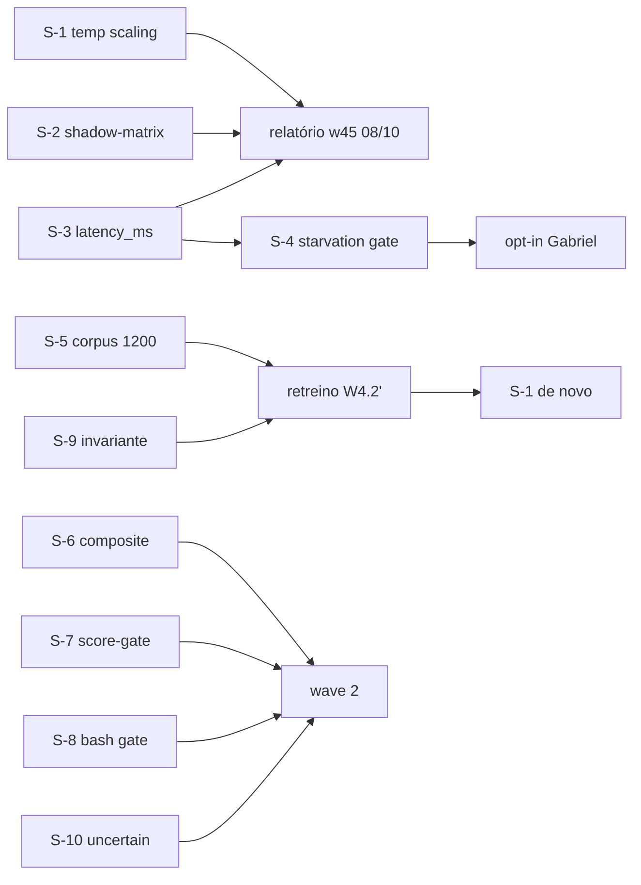

# Plano r2 (Pln2) — Jev harness: cascata calibrada em produção

> Level: **L3** | Registry: 30.4.89 → 30.4.90+ | Scope: 10 subtasks | Bundle: [index](/index.md)
> Estratégia: [strategy](/strategy-2026-10-01-jev-harness-r2.md) · Ground truth: [data/ground_truth.json](/data/ground_truth.json)

## 1. Ground Truth Summary [FACT]

- e2e **0.856** (blind critic 02) · composite **0.9259 Platinum** (diagnostic 19:53) · orphans **761** · suites: **2.624 cargo + 39 scripts, 0 falhas** (medidos 01/10)
- Símbolos VGP-verificados: `journal_intent_decision` (`crates/touring-hook-runtime/src/prompt_enhance.rs:258`) · `student_classify` (`:383`) · `recommend_tau` (`scripts/g2_calibration.py:63`) · `parse_systemone_body` (`scripts/laya_student_server.py:80`) · `mps.fit_temperature` (notebook MPS, chamado em `scripts/w43_calibrate.py:55`)
- Lições aplicadas: `lesson:evolution-loop-roda-no-bridge-mcp` (prova no binário que EXECUTA) · `lesson:cross-audit-jev-bundle-2026-10-01` (edge-case do propósito) · `decisao:estrategia-jev-r2`
- Telemetria âncora: suporte aluno **22,5%** · fallback day-0 **0,9375** (braço OFF) · recall **242/0** · corpus **800** (< piso 1.000) · latência journal **None**

## 2. 9-Dimension Scores (current → target)

| Dim | Cur | Tgt | Amplificação |
|---|---|---|---|
| a Precision | 8 | 9 | todos os file:line VGP-verificados acima |
| b Scalability | 7 | 8 | W6 pesos em touring.toml (sem re-prompt); W9 invariante do trainer |
| c Performance | 7 | 8 | aluno p50 9,9ms local; W1 sem retreino; W10 ~10ms advisory |
| d Functionality | 8 | 9 | W2 usa resposta do aluno hoje DESCARTADA (abaixo do τ) |
| e Quality | 8 | 9 | todo subtask com teste nomeado + RED-GREEN |
| f Detail | 8 | 8 | schemas de journal em S-2/S-3; contratos de gate em S-4 |
| g Integration | 8 | 9 | decision.rs (02) integrado em S-3/S-4; CEG em S-8 |
| h Dependencies | 7 | 8 | zero deps novas (stdlib + crates existentes) |
| i Potentiation | 8 | 9 | matrix §6 — cada S destrava a próxima wave |

## 3. Phases

### Phase 1 (A) — calibração e medição (parallel, policy: `best_effort`) — **esta semana, antes de 08/10**

#### S-1 [W1] Temperature scaling para suporte [P0] [confidence: FACT no mecanismo; INFERENCE 0.75 no efeito]
- **File**: `scripts/w44_support_fit.py` (NOVO) · consome os mesmos logits val de `scripts/w43_calibrate.py:55` (`mps.fit_temperature`)
- **Change**: grid search 1-D T ∈ [0,4; 1,2] passo 0,02 sobre os logits do val congelado; objetivo **max support@τ=0,6 s.t. accuracy ≥ 0,90**; grava o T* em `rl_agent_config.json` (mesma posição de `w43_calibrate.py:58`); relatório com curva suporte×T e acc×T
- **Blast radius**: 0 (script novo; config lida pelo aluno no boot)
- **Test**: `scripts/test_w44_support_fit.py` — logits sintéticos sub-confiantes (curva conhecida): T* < 1,0 recupera suporte alvo **e** acc nunca abaixo do piso; T=1,2 nunca escolhido numa curva sub
- **Enables**: w45 de 08/10 mede o suporte novo; W4 (retreino) herda o objetivo

#### S-2 [W2] Shadow-matrix no prompt_enhance [P0] [confidence: FACT]
- **File**: `crates/touring-hook-runtime/src/prompt_enhance.rs:383` (`student_classify`) e `:258` (`journal_intent_decision`)
- **Change**: quando o aluno responde ABAIXO do τ (ou `student_enabled()` off mas servidor no ar), journal `{source:"laya_shadow", intent, max_prob, confidence, path}` — a decisão NÃO muda (keyword segue); zero custo de comportamento
- **Blast radius**: 46 (medido); delta restrito ao ramo student + journal
- **Test**: `prompt_enhance::tests::shadow_line_on_low_confidence_and_decision_unchanged` — resposta 0,4 → linha shadow + intent final keyword; servidor fora → nenhuma linha shadow (fail-open)
- **Enables**: matriz de concordância no w45; a bifurcação "τ errado × modelo incerto" respondida com dado

#### S-3 [W3] latency_ms no decision journal [P0] [confidence: FACT]
- **File**: `crates/touring-hook-runtime/src/prompt_enhance.rs:258` + `crates/touring-cli/src/cli/kpi/decision.rs` (02 — coordenar)
- **Change**: `Instant::now()` no classify; campo `latency_ms` no payload do journal; KPI `decision` ganha histograma de latência por source (laya/keyword/shadow)
- **Blast radius**: 46 + arquivo da 02 (dono: ela edita)
- **Test**: `journal_line_carries_latency_ms_non_negative` + KPI expõe `latency_p50_ms`
- **Enables**: critério de rollback por latência (>500ms) medido; SLA do aluno

### Phase 2 (B) — gate (sequential) — **com o opt-in de Gabriel**

#### S-4 [W5] Starvation gate no KPI decision [P1] [confidence: FACT no critério; doc-oficial]
- **File**: `crates/touring-cli/src/cli/kpi/decision.rs` (dono: 02)
- **Change**: check nomeado `starvation_gate`: `keyword_fallback_rate` em janela 7d **com `TOURING_LAYA_INTENT=1`** > 0,95 → `unmet` + próxima-ação "revisar τ/T ou rollback do braço" (a doc: rollback/stop); com a flag OFF → `not_armed` (o número é desenho, não deriva)
- **Test**: journals sintéticos — flag ON+rate 0,99 → gate dispara; flag OFF → not_armed; flag ON+rate 0,80 → pass
- **Enables**: o opt-in de Gabriel ganha rede de segurança em código (Lei L2)

### Phase 3 (C) — corpus (parallel) — **próxima wave de treino**

#### S-5 [W4] Corpus 800→1.200 em prompts de produção [P1] [confidence: FACT piso; INFERENCE 0.7 efeito]
- **File**: `scripts/w46_teacher_cascade.py` (NOVO) · corpus `~/.claude/touring/g1-corpus/`
- **Change**: amostra 400 prompts do intent journal de produção (dedup por hash); Jev rotula (1 chamada batch); professor Claude só nos desacordos/baixa confiança; formato G1; split seed congelado (20260922 preservado + extensão 20261001)
- **Test**: determinismo (mesmo input → mesmos rótulos via cache) + formato válido + zero prompts vazios + contagens 800→1200
- **Enables**: retreino W4.2′ + S-1 de novo (suporte sobe nas duas alavancas: distribuição e dados)

### Phase 4 (D) — features (parallel, policy: `best_effort`) — **wave seguinte**

#### S-6 [W6] Composite scoring no pre-review [P1] [confidence: FACT padrão-oficial]
- **File**: `scripts/pre_review_triage.py` + `.touring/touring.toml` (`[triage.weights]`)
- **Change**: +3 Scores (security risk 0–2, pattern alignment, diff quality) na MESMA chamada; composite = Σ wᵢ·sᵢ **em código**; log por dimensão; advisory sempre (exit 0)
- **Test**: pesos alterados mudam o composite **sem** re-chamar o modelo (cache replay prova "tuning sem re-prompt")
- **Enables**: o gate de risco semântico afinável por número, não por prompt

#### S-7 [W8] Score-gate de recall [P1] [confidence: FACT gargalo medido]
- **File**: `~/.claude/hooks/session_startup_intelligence.py` + replay `scripts/s54_replay.py`
- **Change**: (a) PRIMEIRO no replay: score-gate (1 Score por candidato, 1 chamada) → injeta só score ≥ τ_recall (τ medido no replay, regra `recommend_tau`); (b) recuperação: contador `missing_from_recall` (s54: 21/39) vira métrica do journal — atacar a busca antes da ordenação
- **Test**: replay com score-gate → injected > 0 com precisão medida; missing counter presente
- **Enables**: curated_share sai de 0,0 medido para um número governado por τ

#### S-8 [W10] Bash gate semântico (CEG × aluno) [P2] [confidence: INFERENCE 0.8]
- **File**: `crates/touring-hook-runtime/src/ceg_impls.rs` (advisory) + aluno local
- **Change**: comandos NÃO classificados pelo pattern-matcher → reversibility Score do aluno (~10ms) → advisory `ceg_semantic_reversibility` (nunca hard-deny por palpite; só enriquece a decisão)
- **Test**: comando novel ("find -delete" variante) → advisory com score; comando conhecido → zero custo (não chama)
- **Enables**: o buraco dos desconhecidos fecha sem custo de API

#### S-9 [W9] Invariante de taxonomia do trainer [P2] [confidence: FACT doc]
- **File**: `scripts/w42_prepare_items.py` + `docs/memory-hashtag-library.md`
- **Change**: assert fail-loud `n_labels ≤ 20` (doc: flat choice degrada; 77 → 0,425); acima → erro nomeando hierarquia beam-search
- **Test**: 21 rótulos → SystemExit com a mensagem; 20 → passa
- **Enables**: kinds podem crescer sem surpresa silenciosa

#### S-10 [W7] "Uncertain" como outcome [P2] [confidence: FACT cookbook self-consistency]
- **File**: `scripts/pre_review_triage.py` + `scripts/g2_calibration.py` (banda média documentada)
- **Change**: probabilidades na banda 0,5±0,1 → `outcome:"uncertain"` (roteável p/ humano/Sistema 2), nunca binário forçado; relatório conta uncertain à parte
- **Test**: noul 0,52 → uncertain; 0,9 → yes; 0,1 → no
- **Enables**: roteamento honesto de incerteza em todo o harness

## 4. DAG



Políticas: Phase A/D `best_effort` (uma falha não afunda as irmãs); B/C `all`.
when_not_to_use: S-1 se o retreino (C) já estiver agendado para a mesma semana
(as duas alavancas medidas juntas confundem atribuição); S-4 com a flag OFF.

## 5. Verification Protocol

```bash
cargo test -p touring-hook-runtime -p touring-cli --lib        # S-2/S-3/S-4
python3 -m pytest scripts/test_w44_support_fit.py scripts/test_s54_replay.py -q
touring-quality check --gate F2.4 --target <FILE>  # + F2.1 F2.5 F2.6 F4.3 F4.5 (6 BLOCK, cada arquivo tocado)
touring-quality score <target> --workspace --fail-below 0.80   # piso Gold
touring e2e -j                                                  # baseline 0.856 — sem regressão
# convergência: loop_converged.py --task <id> --scope . exit 0
```

## 6. Potentiation Matrix

| Change | Enables |
|---|---|
| S-1 T* | suporte medido no w45 · objetivo herdado pelo retreino |
| S-2 shadow | matriz de concordância · a decisão τ×T com dado (S-4) |
| S-3 latency | rollback por latência · SLA do aluno |
| S-4 gate | opt-in de Gabriel com rede de segurança |
| S-5 corpus | retreino no piso documentado · deriva atacada na fonte |
| S-6 composite | tuning de risco por número · auditável por dim |
| S-7 score-gate | curated_share governado · recuperação medida |
| S-8 bash gate | desconhecidos cobertos · CEG semântico |
| S-9 invariante | crescimento de kinds sem cliff de acurácia |
| S-10 uncertain | incerteza roteável · zero binário forçado |
