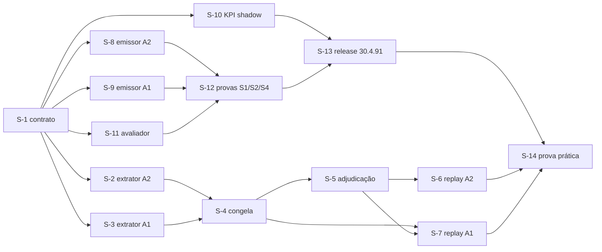

# Plano r3 (Pln2) — Jev/Laya em modo sombra: A1 e A2

> Level: **L3** (cli_suggester.rs blast 22; prompt_enhance.rs 48 não é tocado) | Registry: 30.4.90 → 30.4.91 | Scope: 14 subtasks
> Critérios: [CRITERIOS-ACEITACAO](/CRITERIOS-ACEITACAO.md) (pré-registrados 12:45, Errata 1 12:48 — **vinculantes**) ·
> Ground truth: [harness-scan-t03](/harness-scan-t03.md) (25/25 file:linha validadas por script) · [ground_truth.json](/data/ground_truth.json)

## 1. Ground Truth Summary [FACT]

- e2e **0.8573** (30.4.90, mediana n=5 = 0,857) · doctor ok · release **30.4.90** em produção (global, analise, konverter).
- **Injeção** (KPI `context_budget` = FAIL): 5.724 B/turno vs teto 3.000 · duplicação 0,221 vs 0,05 · 31,5% da janela. **Mas** a família `other` (68,4% dos bytes) é o catch-all do KPI (`crates/touring-cli/src/cli/context_budget.rs:184`) e seus maiores blocos são a lista de skills do harness (~90 KB) e o buffer REMEMBER (~22 KB): **o Touring emite ~31% da injeção** — esse é o universo do A1 (Errata 1, E1.1).
- **A2**: `classify_route_outcome` (`crates/touring-cli/src/cli_suggester.rs:4482`) = detector de 1ª ocorrência (`cmd.contains("touring run ")`/`"touring exec "`, `:4490`), sem consumir a oferta quando devolve `None` (`:4885-4886`). `code_mode_arm.json`: `code` 475 oferecidas / 208 seguidas / 179 econômicas; `both`/`native` = 0.
- **Dados**: 592 sessões com par `pre-bash`↔`post-tool-rl` (51.243 / 81.296 eventos, junção por `session_id`+`ts_ms`); `run_journal` (23.374 L) grava **hash**, não código; `jev_journal` (1.523 L) grava enum/ids.
- **Aluno local**: `scripts/laya_student_server.py` porta 8971, timeout 200 ms (`crates/touring-hook-runtime/src/prompt_enhance.rs:400-406`), checkpoint **multilíngue** `convaiinnovations/laya`; **VRAM 5.897 MiB livres**, serviço inativo. Hot path síncrono e sem canal (`crates/touring-hook-handlers/src/hooks/post_tool_rl.rs:297-315`); p95 do suggester 396 ms ⇒ **o aluno nunca é chamado no caminho quente**.
- **Hardware** (`hw-slot` g2): rust=1, heavy=2; CPUs 8-11 offline; `CARGO_BUILD_JOBS=4`. Notebook do Jev/Laya: zero-shot do Laya base 36–72%, fine-tune estreito ~1.000 rótulos 79–100%; **nenhum modelo é treinado no r3**.
- Lições aplicadas: `lesson:s1-metrica-errada` (métrica com fórmula antes de limiar) · `lesson:hw-slot-fd-herdavel` · `lesson:rodada-r2-done-falso-sem-comando` · `decisao:r3-shadow-a1-a2` (aprovado por Gabriel 02/10).

## 2. 9-Dimension Scores (current → target)

| Dim | Cur | Tgt | Amplificação |
|---|---|---|---|
| a Precision | 8 | 9 | todos os file:linha vêm do scan t03 (25/25 por script) |
| b Scalability | 7 | 8 | schema de evento único (`use_case`) reaproveitável por A3/A4 do r4 |
| c Performance | 7 | 8 | emissão = 1 append atômico; zero chamada de modelo no caminho quente; S1 mede |
| d Functionality | 8 | 9 | A1 e A2 observáveis em `touring kpi`; replay reproduzível por hash |
| e Quality | 8 | 9 | todo subtask com teste nomeado; prova por mutação nos guards; juiz `--rust-full` |
| f Detail | 8 | 9 | contratos de evento e de adjudicação com campo, tipo e exemplo |
| g Integration | 8 | 9 | emissor no `hook_runtime`/`post_tool_rl`; KPI no `kpi.rs`; avaliador fora do daemon |
| h Dependencies | 8 | 8 | zero deps novas em Rust; Python stdlib + `jev_client` já vendado |
| i Potentiation | 8 | 9 | matrix §6 — cada S destrava o r4 (advisory) com número, não opinião |

### 2.1 Amplificação (dimensões < 7 no `dimension_scorer`)

**Escalabilidade — ponto de extensão.** O contrato (S-1) define um **registry de `use_case`**: cada caso de uso é uma entrada `{use_case, event_kind, arms[], metric, floor}` num único arquivo `scripts/r3_use_cases.py`. Adicionar A3 (comando destrutivo) ou A4 (roteamento de modelo) no r4 = acrescentar uma entrada + um braço, **sem** tocar no emissor, no avaliador nem no KPI (que agrupa por `use_case`). Estratégia horizontal: o avaliador é um processo à parte com offset durável — N avaliadores por `use_case` só exigem partições do mesmo arquivo de eventos.

**Performance — alvos numéricos.** Emissão: **1 `write_all` O_APPEND por evento**, alvo **p99 ≤ 1 ms** e **0 chamadas de rede/modelo** no hook; O(1) por evento. Avaliador: ≥ **50 eventos/s** em CPU (braço B-D), ≥ 20/s com Laya local na RTX 4060 (19–33 ms por decisão segundo as fontes), Jev API em lote assíncrono (p95 observado 396 ms; **teto de reporte 800 ms**). Replay: O(n) sobre n ≤ 10⁵ eventos; bootstrap 10 000 reamostragens = O(10⁴·n_audit) com n_audit ≤ 144. Guard de entrega **S1**: p95 de `cli-suggest` ≤ 1,10× o dos 7 dias anteriores ou ≤ +20 ms. Medição por `hook_trace.jsonl` (`elapsed_ms`).

**Funcionalidade — símbolos públicos novos e seus consumidores.** (1) `r3_shadow_enabled()` e `emit_r3_event()` em `crates/touring-hook-runtime/src/r3_shadow.rs` (NOVO) — consumidos por S-8 (`cli_suggester.rs`/`post_tool_rl.rs`) e S-9 (`hook_runtime.rs`); o crate dono do helper é o que ambos os chamadores já dependem (S-8 confirma com `touring ast workspace-info` → `dependents_of` antes de criar). (2) `kpi::shadow::run()` — consumido por `kpi.rs` (registro do check). (3) `scripts/r3_use_cases.py::REGISTRY` — consumido por S-6, S-7, S-11. **Nenhum pub órfão**: o juiz mede `orphans ≤ baseline` e cada símbolo acima tem o consumidor nomeado.

**Dependências — versões e flags.** Rust: **zero dependências novas** (`serde_json` e `std` já presentes). Python ≥ 3.11 (ambiente: 3.14), só stdlib + o SDK `typesafe` **0.7.2** já vendado em `scripts/jev_client.py` (verificado na rodada anterior). Laya: snapshot HF de `convaiinnovations/laya` subdiretório `multilingual`, **hash do snapshot gravado no relatório** (reprodutibilidade). Flags: `TOURING_R3_SHADOW` (default OFF) e `[shadow] r3 = true` em `.touring/touring.toml`; precedência env > toml. Sem `deny_unknown_fields` no loader do toml (verificado em M4a).

**Integração — cada subtask ligada a um fio real.** S-8→`post_tool_rl.rs:297-315` e `cli_suggester.rs:4533,4880`; S-9→`hook_runtime.rs:163-184`; S-10→`kpi.rs` + leitor de janela de `kpi/decision.rs:66,96`; S-11→arquivo `r3_events.jsonl` (saída de S-8/S-9) e `r3_shadow.jsonl` (entrada de S-10); S-12→`hook_trace.jsonl`; S-13→`update-touring`/`daemon-ctl`. Fluxo novo: emissor (daemon) →(JSONL)→ avaliador (processo) →(JSONL)→ KPI (CLI) — todo o acoplamento é por arquivo, sem canal nem thread novos no daemon.

**Potenciação — efeito composto.** O registry + o schema único fazem o custo marginal de cada caso de uso novo cair a "uma entrada e um braço"; o replay por hash vira o protocolo padrão de qualquer decisão de modelo (o que faltou ao S-1 do r2); o avaliador é o worker do advisory do r4; o par `hw-slot` + `Monitor` fica como padrão de execução pesada coordenada.

## 3. Phases

### Phase 0 — Contrato (sequential, policy: `all`) — ticket `kind=decision fog=clear`

#### S-1 [W0] Contrato de eventos, privacidade e flag [P0] [confidence: FACT no desenho; INFERENCE 0.8 na adequação do schema]
- **File**: `docs/plans/2026-10-02-jev-harness-r3/data/EVENT-CONTRACT.md` (NOVO) · `scripts/r3_event_schema.py` (NOVO)
- **Source truth**: `journal_student_shadow` grava `intent` enum, nunca o prompt (`crates/touring-hook-runtime/src/prompt_enhance.rs:486-496`); `append_json_line` é o único caminho de append atômico (`crates/touring-hook-runtime/src/hook_trace.rs`, doc "single `write_all` over O_APPEND").
- **Change**: define 3 tipos de linha JSONL — `a2_offer_closed` (modo, `offered_secs`, até 3 `cmd_head` ≤ 80 chars, `baseline_value`, `closed_by`: consumed|window|replaced), `a1_block` (hook, bytes, sha1 da 1ª linha, `first_line_head` ≤ 80), `shadow_decision` (do avaliador: `use_case`, `arm`, `would_drop`/`p_followed`, `latency_ms`); arquivos `~/.claude/touring/logs/r3_events.jsonl` (emissor Rust) e `r3_shadow.jsonl` (avaliador); flag `TOURING_R3_SHADOW` **default OFF** (ou `[shadow] r3 = true` no `.touring/touring.toml`, precedência env > toml); validador Python do schema + varredura de privacidade (S6).
- **Blast radius**: 0 (documento + script novo)
- **Test**: `scripts/test_r3_event_schema.py::test_free_text_over_80_chars_is_rejected`, `::test_jev_payload_has_only_redacted_features`, `::test_each_event_type_roundtrips`
- **Dimensions**: [a:8, f:9, e:8]
- **Enables**: S-8/S-9/S-10/S-11 compilam e testam contra o MESMO contrato; S6 vira teste, não promessa

### Phase 1 — Ciência offline: dados e replay (policy: `best_effort`; dono MiniMax) — ticket `kind=implementation fog=clear`

#### S-2 [W1] Extrator de ofertas A2 + B0 fiel [P0] [confidence: FACT no desenho; INFERENCE 0.8 na reconstrução a partir dos transcripts]
- **File**: `scripts/r3_extract_a2_offers.py` (NOVO) → `data/a2_offers.jsonl`
- **Source truth**: `record_route_offer` guarda a oferta pela chave da sessão e a nova substitui a anterior (`crates/touring-cli/src/cli_suggester.rs:4533-4545`); `claim_route_reward` não consome a oferta quando o classificador devolve `None` (`:4880-4895`); testes de referência `crates/touring-cli/src/cli_suggester_tests.rs:3972-3999`.
- **Change**: percorre os transcripts do projeto touring (desde 26/08), acha as ofertas de rota (nega/hint de code mode com `touring run`), e anexa os **próximos K=3 Bash** da sessão (cortados na próxima oferta, E1.4), texto truncado a 200 chars; calcula **B0 = porte fiel de `classify_route_outcome` aplicado sequencialmente** (E1.2) incluindo `ProgramShape::Trivial`→0,5.
- **Blast radius**: 0 (leitura de transcripts; script novo)
- **Test**: `scripts/test_r3_extract_a2_offers.py::test_b0_matches_the_rust_reference_table` (as 3 linhas de `cli_suggester_tests.rs:3975-3983` + bypass por env), `::test_window_is_cut_at_the_next_offer`, `::test_offer_without_followup_is_not_followed`
- **Dimensions**: [a:9, e:9, f:8]
- **Enables**: S-4 congela; S-6 compara; B0 fiel é o adversário de todo modelo

#### S-3 [W1] Porte fiel de `injection_family`/`count_propositions` + extrator A1 [P0] [confidence: FACT no desenho; INFERENCE 0.8 na paridade]
- **File**: `scripts/r3_extract_a1_blocks.py` (NOVO) → `data/a1_blocks.jsonl`
- **Source truth**: taxonomia ÚNICA em `crates/touring-cli/src/cli/context_budget.rs:141` (tabela `:142-178`, catch-all `:184`), proposições em `:196`, vereditos `:717-728`, entrada `context_budget(project_root)` `:780`.
- **Change**: lê os `attachment` de injeção dos transcripts, classifica pela tabela portada, marca **EXEMPT** (E1.1: família `code-mode-deny` + marcadores `MUST`/`REGRA #`/`CRITICAL`/`BLOCK`/erro de hook) e duplicata exata (janela de 5 turnos); mantém **só as 6 famílias do Touring**; grava a decomposição Touring × harness (para C-A1-4).
- **Blast radius**: 0
- **Test**: `scripts/test_r3_extract_a1_blocks.py::test_family_table_parity_with_context_budget_kpi` (mesmos transcripts → bytes por família dentro de 1% do `touring kpi -j`), `::test_exempt_markers_are_never_droppable`, `::test_other_family_is_excluded_from_the_universe`
- **Dimensions**: [a:9, e:8, g:8]
- **Enables**: S-7 (replay A1); a paridade com o KPI prova que o replay mede a MESMA coisa que a produção

#### S-4 [W2] Congelamento, split e audit sample [P0] [confidence: FACT]
- **File**: `scripts/r3_freeze_dataset.py` (NOVO) → `data/MANIFEST.sha256`, `data/splits.json`, `data/audit_sample.jsonl`, `data/exempt_markers.json`
- **Change**: split temporal 60/20/20 por sessão (seed `20261002`); audit sample **n=240 estratificado pela decisão de B0 (120 followed / 120 not-followed)**, 40% `audit-val` / 60% `audit-test` (E1.3); sha256 de cada artefato no manifesto; modo `--check` que relê e confere.
- **Blast radius**: 0
- **Test**: `scripts/test_r3_freeze_dataset.py::test_check_detects_a_single_changed_byte`, `::test_no_session_crosses_partitions`, `::test_audit_sample_is_balanced_by_b0`
- **Dimensions**: [a:8, e:9]
- **Enables**: S-5/S-6/S-7 só leem o que o manifesto atesta; "gravar não é congelar" (lição do r2)

#### S-5 [W2] Adjudicação cross-vendor do audit sample [P0] [confidence: INFERENCE 0.75 — κ pode reprovar]
- **File**: `scripts/r3_adjudication.py` (NOVO: `pack` / `merge`) → `data/adj_*.jsonl`, `data/gold_a2.jsonl`
- **Change**: `pack` gera pacotes CEGOS (nudge + 3 Bash, sem a decisão de B0); **Kimi e MiniMax** rotulam independentemente (`followed|ignored|bypass|indeterminate`); `merge` calcula κ de Cohen, o gold (acordo) e a fila de desacordos para desempate por Claude Sonnet; **κ < 0,60 declara o gold INSUFICIENTE** (§2 dos critérios). Mesmo protocolo para o harm-check do A1 (n=100, S-7).
- **Blast radius**: 0
- **Test**: `scripts/test_r3_adjudication.py::test_pack_never_leaks_the_b0_label`, `::test_kappa_matches_a_hand_computed_case`, `::test_low_kappa_flags_gold_insufficient`
- **Dimensions**: [e:9, f:8]
- **Enables**: S-6 tem verdade-terreno independente de quem é julgado

#### S-6 [W3] Replay A2: B0 × Laya local × Jev API [P0] [confidence: INFERENCE 0.7 no efeito; FACT no método] — ticket `fog=hazy`
- **File**: `scripts/r3_replay_a2.py` (NOVO) → `data/report-a2.md`, `data/results-a2.json`
- **Change**: três braços sobre `audit-test`: B0; **B-L** Laya multilíngue zero-shot (GPU sob `hw-slot -- …`); **B-J** Jev API **só com features redigidas** (`jev_client` vendado); τ calibrado em `audit-val` (máx. cobertura s.t. precisão ≥ 0,90); acordo binário, bootstrap pareado (10.000, seed 20261002), C-A2-1..4 avaliados mecanicamente contra os limiares **congelados**.
- **Blast radius**: 0 (consome `jev_client`; escreve só em `data/`)
- **Test**: `scripts/test_r3_replay_a2.py::test_bootstrap_is_seeded_and_reproducible`, `::test_tau_is_chosen_on_val_only`, `::test_jev_payload_has_no_free_text`, `::test_verdict_uses_the_frozen_thresholds`
- **Dimensions**: [a:8, c:8, e:9]
- **Enables**: decisão do r4 sobre A2 com número; se B0 ≥ 0,95 de acordo, "regex basta" e A2 fecha

#### S-7 [W3] Replay A1: B0 × B-D (regra) × B-L × B-J + harm-check [P0] [confidence: INFERENCE 0.7 no efeito; FACT no método] — ticket `fog=hazy`
- **File**: `scripts/r3_replay_a1.py` (NOVO) → `data/report-a1.md`, `data/results-a1.json`
- **Change**: braços sobre a partição `test` do universo Touring: **B-D** (descartar 0-proposição não-EXEMPT + duplicata exata), **B-L**/**B-J** (B-D + P(followed) < τ nos blocos de nudge); bytes economizados, followed-recall, EXEMPT retidos (C-A1-1); harm-check n=100 cross-vendor (C-A1-2); incremento do modelo sobre B-D (C-A1-3); decomposição Touring × harness do `injected_bytes_per_turn` (C-A1-4, informativo).
- **Blast radius**: 0
- **Test**: `scripts/test_r3_replay_a1.py::test_an_exempt_drop_invalidates_the_arm`, `::test_followed_recall_counts_only_nudges`, `::test_model_increment_is_measured_over_b_d_not_b0`
- **Dimensions**: [a:8, e:9, d:9]
- **Enables**: separa o ganho da REGRA do ganho do MODELO — se a regra basta, o modelo não é adotado (resultado válido)

### Phase 2 — Instrumentação online (policy: `best_effort`; dono Kimi, trilha Rust) — ticket `kind=implementation fog=clear`

#### S-8 [W4] Emissor A2: ciclo de vida da oferta [P0] [confidence: FACT no ponto de inserção; INFERENCE 0.75 na mudança de `RouteOffer`]
- **File**: `crates/touring-cli/src/cli_suggester.rs:4533` (`record_route_offer`) e `:4880` (`claim_route_reward`) · `crates/touring-hook-handlers/src/hooks/post_tool_rl.rs:297-315`
- **Source truth**: `RouteOffer { mode, offered_secs }` no cache `route_offers()`; a oferta é consumida só quando o classificador devolve `Some` (`:4885-4886`); `post_tool_rl` é síncrono e fail-open por desenho (`:290-291`).
- **Change**: com `TOURING_R3_SHADOW` ligado, `RouteOffer` acumula até 3 `cmd_head` (≤ 80 chars) dos Bash seguintes; ao **fechar** (consumida | 3 Bash sem desfecho | substituída por nova oferta) emite UMA linha `a2_offer_closed` via `append_json_line`. Com a flag OFF: zero I/O. A **decisão devolvida por `claim_route_reward` é idêntica** ligado ou desligado.
- **Blast radius**: 22 (`cli_suggester.rs`) — mudança L3, escopo mínimo
- **Test**: `cli_suggester_tests::r3_flag_off_does_no_io`, `::r3_closed_offer_emits_exactly_one_line`, `::r3_claim_route_reward_is_identical_with_the_flag_on`, `::r3_emission_failure_never_changes_the_return`
- **Dimensions**: [a:9, c:9, e:9, g:8]
- **Enables**: dados online do A2 (S3: cobertura ≥ 95%); evaluator S-11 consome

#### S-9 [W4] Emissor A1: bloco injetado no PreToolUse [P0] [confidence: FACT no ponto de gate; INFERENCE 0.7 no escopo]
- **File**: `crates/touring-hook-runtime/src/hook_runtime.rs:163-184`
- **Source truth**: `{"additionalContext": truncated}` é criado em `:163`, escrito em `:184`/`:204` — "o único ponto por onde passa toda injeção de PreToolUse" (scan §1.2).
- **Change**: com a flag ligada, ANTES da escrita, 1 linha `a1_block` (hook, bytes, sha1 da 1ª linha, `first_line_head` ≤ 80). **Não classifica família aqui** (a taxonomia vive em `touring-cli`; o avaliador a porta e prova paridade em S-3). **Não altera `additionalContext`**. Escopo online do r3 = injeções de PreToolUse (família `touring-suggest` = 64,8 KB, a maior do Touring); `session-start`/`post-tool-echo` ficam cobertos só pelo replay.
- **Blast radius**: a medir com `touring ast blast` antes de editar (alvo ≤ 10)
- **Test**: `hook_runtime_tests::r3_a1_block_is_emitted_and_additional_context_is_byte_identical`, `::r3_flag_off_emits_nothing`
- **Dimensions**: [a:9, c:9, e:9]
- **Enables**: dados online do A1; S4 (byte-idêntico) prova que nada mudou

#### S-10 [W4] KPI `shadow` em `touring kpi` [P1] [confidence: FACT]
- **File**: `crates/touring-cli/src/cli/kpi/shadow.rs` (NOVO) · registro em `crates/touring-cli/src/cli/kpi.rs`
- **Source truth**: precedente de leitor com janela de 7 dias e `JevTally` em `crates/touring-cli/src/cli/kpi/decision.rs:66,96,429-448`.
- **Change**: check `shadow` por `use_case`: n_eventos, acordo B0×arm, descartes, latência p50/p95, `dropped` do emissor; `unmeasured` (nunca 0) quando não há linha; **não toca no KPI `decision`** (journals separados).
- **Blast radius**: 4 (`kpi.rs`)
- **Test**: `kpi::shadow::tests::empty_journal_is_unmeasured_not_zero`, `::agreement_is_computed_per_use_case`, `::intent_decision_kpi_is_unaffected`
- **Dimensions**: [d:9, e:9, g:8]
- **Enables**: S5; o número do r4 sai de um comando, não de um script solto

#### S-11 [W4] Avaliador de shadow (Python) [P0] [confidence: INFERENCE 0.8] — dono MiniMax
- **File**: `scripts/r3_shadow_evaluator.py` (NOVO) · unit opcional `scripts/laya-r3-shadow.service`
- **Change**: lê `r3_events.jsonl` (offset durável), aplica os braços (B-D regra; B-L Laya local via loopback/GPU sob `hw-slot`; B-J Jev API com features redigidas) e grava `r3_shadow.jsonl`; **fora do daemon**, fail-open (avaliador parado ⇒ só acumula fila), `--once` para teste.
- **Blast radius**: 0 (processo à parte)
- **Test**: `scripts/test_r3_shadow_evaluator.py::test_offset_survives_restart`, `::test_stopped_evaluator_never_blocks_the_emitter`, `::test_no_free_text_leaves_the_machine`
- **Dimensions**: [c:9, e:9, g:8]
- **Enables**: S2/S3/S6; no r4 vira o worker do advisory

#### S-12 [W5] Provas de entrega S1, S2, S4 [P0] [confidence: FACT no método]
- **File**: `scripts/r3_prove_delivery.py` (NOVO) → `data/PROVA-ENTREGA.json`
- **Change**: **S1** p95 de `cli-suggest` antes/depois (`hook_trace.jsonl`, mesmo script); **S2** derruba o avaliador e mede `exit_reason`; **S4** reproduz **200 entradas reais de PreToolUse** (de transcripts) pelo hook com a flag ON/OFF e exige diff = 0 bytes.
- **Blast radius**: 0
- **Test**: `scripts/test_r3_prove_delivery.py::test_s4_detects_a_one_byte_difference`, `::test_s1_threshold_uses_the_prior_7_day_p95`
- **Dimensions**: [e:9, c:8]
- **Enables**: S1–S4 deixam de ser promessa; entram no relatório final

### Phase 3 — Entrega (sequential, policy: `all`) — ticket `kind=implementation fog=clear`

#### S-13 [W6] Release 30.4.91 (global) + ligar o shadow só no projeto [P0] [confidence: FACT]
- **File**: `Cargo.toml` (bump) · `.touring/touring.toml` (`[shadow] r3 = true`, local, git-ignorado)
- **Change**: bump 30.4.90 → 30.4.91 **antes** do build (lição `bump-de-versao-antes-do-build`); `hw-slot --class rust -- update-touring` (restart do daemon GLOBAL); **projetos pinados (analise, konverter) NÃO são propagados** (fora do r3); flag default OFF em produção — ligada apenas via `.touring/touring.toml` deste projeto para a prova.
- **Blast radius**: daemon global (2–3 s de degraded; sem janela de terceiros)
- **Test**: `touring --version` = 30.4.91, `touring daemon-ctl status` (exe não deletado), `touring doctor -j` 9/9, `touring e2e -j` sem regressão por componente
- **Dimensions**: [e:9, g:8]
- **Enables**: o emissor roda no daemon real (lição "quem EXECUTA não é quem compila")

### Phase 4 — Prova e fechamento (sequential, policy: `all`) — ticket `kind=implementation fog=clear`

#### S-14 [W7] Prova prática, resultados e memória [P0] [confidence: FACT por execução]
- **File**: `docs/plans/2026-10-02-jev-harness-r3/RESULTS.md` · `PROVA-PRATICA.md` (NOVOS)
- **Change**: aplica **mecanicamente** os critérios congelados a `results-a1.json`/`results-a2.json` (PASSA / PARCIAL / NÃO ADOTADO PELOS DADOS por braço); roda a prova viva: eventos reais desta sessão no shadow, matriz de concordância, `touring kpi -j` com o check `shadow`, S1–S6, testes e mutantes, juiz `--rust-full`; registra memória/lições e os candidatos do r4.
- **Blast radius**: 0
- **Test**: `scripts/test_r3_results_gate.py::test_verdict_is_computed_from_frozen_thresholds_not_edited_by_hand`
- **Dimensions**: [e:9, f:9, i:9]
- **Enables**: Gabriel decide o r4 (advisory) com evidência; nada é promovido sem o go dele

## 4. DAG



Políticas: Phase 1 e Phase 2 correm **em paralelo** (donos distintos, `best_effort` — uma falha não afunda as irmãs); Phase 0, 3 e 4 `all`.
`when_not_to_use`: S-9 se `touring ast blast` de `hook_runtime.rs` > 10 (voltar a desenhar o ponto de emissão antes de editar); S-13 se QUALQUER teste das S-8..S-12 estiver vermelho ou o juiz não convergir.

## 5. Verification Protocol

```bash
# trilha Rust (Kimi) — sempre sob hw-slot (rust=1, MCE-guard)
hw-slot --class rust --label r3 -- cargo test -p touring-hook-runtime -p touring-hook-handlers -p touring-cli --lib
hw-slot --class rust --label r3-clippy -- cargo clippy --workspace --all-targets -- -D warnings
cargo fmt --check
# trilha Python (MiniMax) e provas
python3 -m pytest scripts/test_r3_*.py -q
python3 scripts/r3_freeze_dataset.py --check            # manifesto íntegro
# 50-dim: 6 BLOCK P0 em cada arquivo tocado + piso Gold
touring-quality check --gate F2.1 --target <FILE>       # + F2.4 F2.5 F2.6 F4.3 F4.5
touring-quality score <target> --workspace --fail-below 0.80
touring e2e -j                                          # por componente (ast/wiring/index/knowledge/quality constantes)
# convergência
python3 ~/.claude/skills/loop-engineering/scripts/loop_converged.py --task <id> --scope /home/gabrielgadea/projects/touring --rust-full   # exit 0
```

## 6. Potentiation Matrix

| Change | Enables |
|---|---|
| S-1 contrato | emissores, KPI e avaliador compilam contra o mesmo schema; S6 vira teste |
| S-2/S-3 extratores com paridade | replay mede a MESMA coisa que a produção mede |
| S-4 congelamento | nenhum número do r3 depende de dado que mudou em silêncio |
| S-5 adjudicação cross-vendor | verdade-terreno independente do agente julgado |
| S-6/S-7 replay | separa o ganho da regra do ganho do modelo; decisão do r4 por número |
| S-8/S-9 emissores | dados online sem tocar o comportamento (S4 prova) |
| S-10 KPI | acompanhar o shadow com um comando |
| S-11 avaliador | vira o worker do advisory no r4 |
| S-12 provas | S1–S4 mensurados, não prometidos |
| S-13 release | o código roda no daemon que executa |
| S-14 prova prática | Gabriel decide o r4 sobre evidência fresca |
