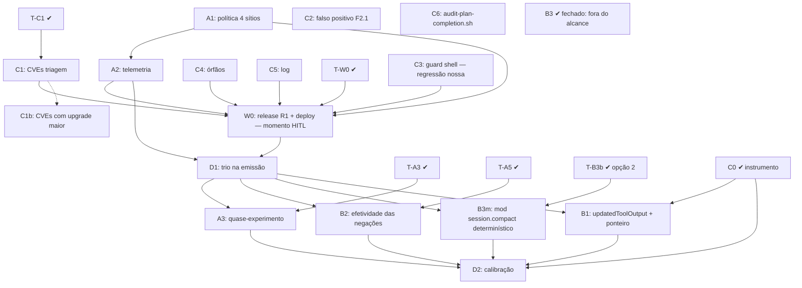

# Eficácia da janela — o plano (Pln2 v3)

> **Autoria**: taco-planning, 26/10/2026; **v2 em 27/10/2026**, sob ordem de
> Gabriel Gadea ("corrija e atualize tudo").
> **v3 (27/10, tarde)**: pendências fechadas por medição (§1.3: F2.1 = falso
> positivo do detector; os 27 testes = **regressão nossa** no guard shell; triagem
> das CVEs por pacote; o log cru é latente) e fontes externas consultadas de novo
> para cada decisão (§1.4: Output Diet, rubrica de deny, `claude plugin eval`,
> reprodutibilidade do harness2, `rtk:posthook`, mods `session.compact`). O
> T-B3 foi **reapresentado** com evidência nova (§3).
> **O que mudou da v1**: a revisão (`REVISAO-2026-10-27.md`, R1–R12) mostrou que
> as premissas da Wave B eram, em boa parte, artefato do instrumento; o
> instrumento foi versionado e corrigido (C0) e o canal de ferramentas foi medido
> de novo (§1.3). As 5 decisões HITL foram **aprovadas** por Gabriel em 27/10
> (`AVALIACAO-DECISOES-2026-10-27.md`, §3). O DAG foi refeito: release único
> antes do deploy, medição depois dele.
> **DAG**: `task_1793043745985215009` (23 subtasks, valid, sem ciclos).
> **Fontes**: corpus de transcripts · Context7 (`anthropics/claude-code`,
> incluindo `mods/types/claude-code.d.ts`) · notebookLM "Claude Code " (91
> fontes, 25/09/2026, certificado) · notebookLM "GitHub Repos" (107 fontes) ·
> `google-research/harness2` (+ arXiv 2610.14224) · `rtk-ai/rtk` ·
> `PrimeIntellect-ai/prime-agent`.

---

## 1. Ground Truth Summary

> Corpora, sempre declarados: **(J)** = janela das rodadas 1-4 (a partição da
> janela por canal: injeção 12,0%, resultados 43,2%, chamadas 24,7%); **(T)** =
> as 200 sessões mais recentes de `-touring`/`-analise`/`-konverter` em
> 27/10/2026 ~12:45, medidas por `scripts/measure_tool_trio.py`. Números de (J) e
> de (T) não se somam nem se comparam diretamente.

### 1.1 O sistema (FACT [1.0], medido em 26/10)

- `cargo check --workspace` → exit 0 · `touring e2e -j` → **0,853** (baseline
  mediano 0,857) · suíte da política **89 PASS / 0 FAIL** · guarda **152/152**
- binários release `target/release/touring{,-daemon}` de **18/10**, medido na manhã de 27/10. **Fato novo (27/10 10:29)**: a sessão `touring-a1` rodou `update-touring` (SEG-3, ordem de Gabriel), reconstruindo os três binários **a partir do working tree**. O daemon (pid 292355) reiniciou às 10:29:02, e a wave S-\* desta frente (F1–F6, não commitada) **entrou no ar**. As edições da Wave 1 feitas depois disso ainda não estão no ar.

### 1.2 O que já está CORRIGIDO (FACT [1.0])

| # | o defeito | a correção | a prova |
|---|---|---|---|
| F1 | `similar-fail` era alerta sem alvo | `FailedPath.subject` + `check_known_failure_detail` | `touring-intelligence/src/reasoning/pensieve.rs` + teste |
| F2 | régua classificava por cabeçalho | taxonomia por conteúdo; catch-all 77,2% → 11,5% | `touring-foundation/src/injection_family.rs` + 29 testes |
| F3 | ordens MUST chegavam inválidas (58,0%) | `directives_only` omite a diretiva que não fecha | `touring-hooks-shared/src/turn_budget.rs` + 4 testes |
| F4 | dedup só na rota do daemon | dedup-stdin nos hooks Python + rota standalone | S-4p |
| F5 | duas taxonomias divergentes | uma canônica em Rust; Python espelha | `injection_policy.rs` 23 testes |
| F6 | `no-advisory` cortava 13,6% | corta 19,7% | `scripts/test_injection_policy.py` 89 PASS |
| F7 | leitura errada da ordem | C13: `additionalContext` = canal do "depois"; decisão = canal do "agora" | `round4/CORRECAO-ORDEM-DE-LEITURA.md` |
| **F8** | instrumento do trio em `/tmp`, com 3 artefatos (classe por 1º token, retry por alvo, negação = erro) | **C0**: `scripts/measure_tool_trio.py` versionado + fixture | `scripts/test_measure_tool_trio.py` **9 PASS**, ruff limpo |

> **Ativo em produção só depois do deploy (W0)**: F1–F6 são código no working
> tree; o binário release é de 18/10.

### 1.3 O que está medido e NÃO corrigido

**Injeção de contexto** (FACT [1.0], corpus J):

- **P-I1** — F1–F6 estão no ar desde 27/10 10:29, por um deploy de outra sessão, sem commit. O R1 continua necessário para levar A1/A2/C1/C3/C4/C5/D1 e para ter um binário **identificável por commit**.
- **P-I2** — a política nativa existe e tem **zero consumidores**: só uma menção
  em doc comment (`injection_family.rs:37`). Os 4 sítios existem:
  `touring-hooks/src/main.rs:699` (`forward_daemon_output`),
  `touring-hooks-core/src/hook_response.rs`,
  `touring-hook-runtime/src/hook_runtime.rs`, `touring-hook-runtime/src/verdict.rs`.
- **P-I3** — telemetria `injection_suppressed_*` não existe.
- **P-I4** — sermão com 0,3% de adesão proximal (18,7% do volume injetado), default `full`.
- **P-I5** — o A/B de desfecho não existe (`s8_corpus_ab.rs` mede bytes).

**Canal de ferramentas** (FACT [1.0], corpus T: 12.791 chamadas, 23,0 MB de
resultado):

| medida | valor | o que significa |
|---|---|---|
| retry (chamada **byte-idêntica** na janela de 8, o predicado do G6) | **1,5%** (194) | quase não há repetição a cortar |
| negado por hook (gate) | **4,2%** (541) | a maior perda medida — cada negação custa uma volta |
| resultado: Read | 9,1 MB (**39,6%**; 4,07 MB só texto, o resto blocos não-texto, como imagens) | o maior canal de resultado |
| resultado: `touring run` / `python3` | 3,5 MB (15,4%) / 2,8 MB (12,0%) | saída de programas do code mode |

A v1 trazia sete premissas sobre este canal. A medição corrigida retrata seis e
confirma uma:

| premissa v1 | re-medição (T) | status |
|---|---|---|
| P-T1 `ctx_execute` 95,1% retry | abaixo de 40 chamadas no corpus T; o alvo (`code`) estava fora do `cmd_norm` | **retratada** (artefato) |
| P-T2 Edit 61,5% retry | **4,3%** byte-idêntico; os 61% eram edições distintas do mesmo arquivo | **retratada** |
| P-T3 `cat` 49,7% eficácia | `cat-write` (heredoc) 330 chamadas, 94,0%; `cat-read` 78 chamadas, 94,9% | **retratada** |
| P-T4 `grep` 77,9% eficácia | **91,0%**; o "erro" era exit 1 = sem match | **retratada** |
| P-T5 `sleep` 57,4% | bloqueio do harness do Claude Code, fora do alcance do Touring | **retirada** |
| P-T6/P-T7 `export`/`cd` retry | prefixos de comando composto (2.246/2.246 `cd` compostos); `updatedInput` não devolve bytes que o modelo já emitiu | **retratadas** |
| P-T8 resultados não comprimidos | `maybe_capture_and_persist` (`post_bash.rs:516`) grava nota + `additionalContext`, ou seja, **soma** bytes | **mantida**, com o canal certo (B1) |

**Achados novos do instrumento corrigido** (FACT, corpus T):

- **P-T9 — negações dos gates**: Edit **9,6%**, Write **8,8%**, `bash` 10,5%,
  `cp` 10,4%, `mkdir` 8,8%, `systemd-run` 7,0%, `python3` 5,0%. Não se sabe
  ainda se a negação leva à rota certa na chamada seguinte (deny → recuperação):
  é a efetividade do gate, e o D1 a mede.
- **P-T10 — Read domina o resultado** (39,6% dos bytes). Uma alavanca possível
  (`limit` por `updatedInput` em leitura grande sem faixa) muda o que o modelo
  recebe: é candidata a reabrir o T-A5, não uma ação aprovada.
- **P-T11 — repetições residuais**: `git diff` 21,3% (136 chamadas) e
  `ListAgents` 16,7% (90, polling). São pequenas e vão para o D1.
- `StructuredOutput` 100% "vazio" é o formato da ferramenta, não desperdício.

**Workspace (REGRA #21)** — pendências **fechadas por medição em 27/10**:

- **P-W1 — `F2_1` P0 = falso positivo do detector** (FACT): o único achado é
  `PathTraversal (CWE-22)` em `crates/touring-server/build.rs:42`,
  `println!("cargo:rerun-if-changed=../../.git/HEAD");`. É uma diretiva de build
  script, não um caminho vindo de entrada. A causa raiz está no detector
  (`crates/touring-analysis/src/quality/security.rs:245`, que já trata exceções
  de PathTraversal), não no `build.rs`.
- **P-W2 — CVEs** (FACT, triagem contra `~/.cargo/advisory-db` de 27/10: 38
  advisories vulneráveis em 11 pacotes). **38 − 4 = 34 do F2.5**: o mesmo db
  (atualizado em 24/10 10:57) e as 4 advisories do quick-xml aceitas no
  `deny.toml` `[advisories] ignore`, com motivo documentado (transitivas via
  `inferno`), que o F2.5 descarta (`f2_5_dep_cves.rs:257`):

  | pacote@versão | advisories | compilado? | patch semver-compatível |
  |---|---|---|---|
  | ctutils@0.4.2 | 1 | **não** | sim (≥ 0.4.4) |
  | quinn-proto@0.11.15 | 5 | **não** | sim (≥ 0.11.18) |
  | rustls@0.23.41 | 4 | sim | sim (≥ 0.23.46) |
  | rustls-webpki@0.103.13 | 1 | sim | sim (≥ 0.103.16) |
  | wasmtime@36.0.14 | 4 | sim | sim (≥ 36.0.19) |
  | webpki-roots@1.0.8 | 1 | sim | sim (≥ 1.0.10) |
  | quick-xml@0.26.0 e @0.39.4 | 2 cada | sim (via `inferno`) | **não** (≥ 0.41) — **risco aceito no `deny.toml`** |
  | wasmtime@46.0.3 | 14 | sim (dep. **direta**: `Cargo.toml:339` `version = "46"`, feature `bind-wasm` do `touring-bindings`) | **não**: a linha 46 não tem patch; ≥ 48.0.7 (linha 48) ou ≥ 49.0.4 |
  | z3@0.20.1 | 1 | sim (dep. **direta**: `Cargo.toml:564`, feature `z3` do `touring-offensive`) | **não** (≥ 0.21) |
  | zip@1.1.4 | 3 | sim (via `candle-core` 0.8.4) | **não** (≥ 9.0, exige subir o candle) |

- **P-W3 — os 27 testes vermelhos são REGRESSÃO NOSSA** (FACT, 27/10, 27 failed /
  1.358 passed). O guard do interruptor que esta wave pôs em
  `client/hooks/check_context.sh:3` (e `doc-coverage-gate.sh:53`) é
  `if ! python3 "$HOME/.claude/hooks/injection_policy.py" --allows … ; then exit 0`.
  Se o arquivo falta (nos testes, `HOME` é um tmp) ou o python quebra (rc 2), o
  hook sai **mudo**: fail-closed na ausência. Os guards Python testam
  `exists()` e são fail-open. A atribuição de 26/10 a "edição de outra sessão,
  zero interseção" estava **errada**.
- **P-W4 — órfãos são pré-existentes** (FACT): `repo_health.rs` (último commit
  24/07) e `modules.rs` (18/10, int97) estão fora do diff desta wave.
- **P-W5 — log com comando cru é latente** (FACT): `TOURING_LOG` tem default
  `off` (`touring-hooks/src/main.rs:57,1328`); só vaza quando alguém liga debug.
- **P-W6** — `audit-plan-completion.sh` ausente (com `--bundle`, o juiz dá FAIL).
- **`Cargo.lock`** (FACT): a única mudança é `+ "touring-hooks-shared"` nas
  dependências do `touring-hooks`, que é desta wave.

### 1.4 Fontes externas e protocolo (FACT onde lido)

| fonte | a medida | onde |
|---|---|---|
| protocolo CC | `updatedToolOutput` (PostToolUse, **todas** as ferramentas) substitui o que o modelo vê do resultado | `mods/types/claude-code.d.ts` (`ClassicResultFields.PostToolUse`) |
| protocolo CC | `updatedInput` substitui os argumentos **antes** de a ferramenta rodar | idem (`PreToolUseResult`) |
| protocolo CC | `PreCompact` não tem `hookSpecificOutput`, só `block`/`stopReason` | idem |
| rtk | 60-90% de redução na saída de comandos dev; reescreve o comando por hook | README master |
| harness2 | ablação: prompt\* −1,5 · skills −5,3 · scripts −3,7; "if you add always-on text, cut something else"; truncamento que fabrica defeito é pior que ausência | Table 6 · `prompts.py:254` · `spec.py:163-167` |
| context-mode | hook programático ~98% vs arquivo-de-instrução ~60% | "GitHub Repos" [61] |
| prime-agent | contexto como variáveis; ferramentas como código; REPL persistente; "a passed gate checks only what that gate verifies" | README main (27/10) |
| CC instalado | **2.1.311**; o binário contém `updatedToolOutput, which works for all tools` (18 ocorrências) | `strings` no binário (27/10) |
| CC mods | `session.compact`: reescreve `instructions`/`messages` ou responde `{ messages }` próprios (evicção **alcançável por mod**); `tool.call` intercepta qualquer ferramenta | `mods/types/claude-code.d.ts` (Context7) |
| notebook "Claude Code " | **Output Diet**: o cru vai para disco, o resultado vira cabeçalho (~12 linhas) + linhas de erro detectadas + rodapé (~15 linhas), teto ~2.400 chars | `65c3ecb1…` q.cc1/cc4 (6 e 12 fontes) |
| notebook "Claude Code " | deny que ensina: (1) a invariante violada, (2) o próximo passo exato, (3) o que fica proibido, (4) prefixo estruturado | q.cc2 |
| notebook "Claude Code " | `claude plugin eval` (v2.1.269+): braços com/sem o plugin automáticos; 20-50 tarefas reais com critério objetivo; pass@k, tokens, chamadas | q.cc5 (13 fontes) |
| harness2 docs | comparar com seleção de tarefas, executor, juiz e acesso à web **fixos**; `--seed` embaralha a ordem, não a amostragem do modelo; baseline julgado à parte (`--bases`); executor com web baixa o gabarito (contaminação) | `docs/EXPERIMENTS.md`, `docs/BENCHMARKS.md` |
| rtk | default = PreToolUse reescreve o comando; `rtk:posthook` (opt-in) comprime no PostToolUse com perda onde o `cap` corta, cru recuperável por `rtk recall <hash>`, **"Benchmark: not published"**; economia estimada em bytes/4, diluída na conta; o hook do Bash não cobre Read/Grep nativos | README + `engine/builtin/posthook.toml` |
| notebook "GitHub Repos" | deny + arquivo de instrução que explica a rota (context-mode); re-injeção cadenciada (`…_NUDGE_EVERY`); LeanCTX com 85+ padrões de saída | `0f7f9b3e…` q.gh1/gh3 |

---

## 2. 9 Dimensions — as 9 dimensões (atual → alvo)

> Autoavaliação. A pontuação do `dimension_scorer.py` vai no §10.

| dim | atual | alvo | a alavanca |
|---|---:|---:|---|
| **a** Precisão | 9 | 9 | premissas re-medidas com instrumento versionado (F8); cada número com corpus |
| **b** Escalabilidade | 6 | 8 | B1 por canal do protocolo (`updatedToolOutput`), uma regra por classe medida |
| **c** Performance | 6 | 8 | D1 mede na emissão; B1 só onde a distribuição de tamanho concentra bytes |
| **d** Funcionalidade | 7 | 9 | REGRA #0: A1 dá consumidor à política; C4 resolve os órfãos |
| **e** Qualidade | 7 | 9 | cada fase com teste nomeado; o instrumento tem fixture dos artefatos |
| **f** Detalhe | 8 | 8 | arquivo:linha medido em cada correção |
| **g** Integração | 7 | 9 | A1 nos 4 sítios; release único R1 |
| **h** Dependências | 6 | 8 | C1 triagem das 34 CVEs (alcançável × corrigível) |
| **i** Potenciação | 7 | 9 | §7 — release → medição → decisão |

---

## 3. As decisões (aprovadas por Gabriel em 27/10/2026)

| ticket | decisão | consequência no plano |
|---|---|---|
| **T-C1** | árvore toda, como triagem, já | C1 lista as 34 com (alcançável? corrigível semver?), `cargo update -p` só de lock para as corrigíveis, documenta o resto |
| **T-W0** | um deploy só (release R1), depois de commit + A1/A2/C1/C4/C5 | W0 depende dessas fases; o **momento** do restart segue confirmado pelo humano (`autonomy hitl`) |
| **T-A5** | nenhuma classe nova de enforcement; o G6 fica | B2 vira "efetividade das negações" (P-T9); reabre só com dado do D1 |
| **T-B3** | fechado: fora do alcance do Touring | B3 encerrado; a intenção vira critério de aceite do B1 (resultado comprimido carrega o ponteiro do cru) |
| **T-B3b** | **DECIDIDO por Gabriel em 27/10: opção (2), mod `session.compact` determinístico do Touring, condicionado ao D1** (desenho a partir dos números do D1; ligado por default só com A/B de desfecho igual ou melhor e menos contexto). Descartados: (0) nada; (1) `fast-jev-compaction`, pelo envio do transcript a terceiro e pela poda de 89–96% medida; (3) híbrido, fica para depois se (2) não bastar. Contexto da reabertura: o fechamento partiu de "o `PreCompact` só pode bloquear", o que vale para hooks de **comando**. Os **mods** do CC 2.1.311 têm `session.compact`, que reescreve as mensagens, e o plugin `fast-jev-compaction` faz exatamente essa evicção (q.cc6: classificador **hospedado**, `api.typesafe.ai`, recebe o transcript + inputs de ferramenta ≤ 1.000 chars, sem os resultados; no default cortou 88,8–96,4% e manteve 0 tool calls em 3 sessões; o 1M → 86k vem de **uma** sessão postada no X, sem checagem de desfecho). | decisão fechada no DAG; implementação **S-16 (B3m)**, que depende de D1, T-B3b e C0 |
| **T-A3** | quase-experimento (d) primeiro; piloto pago (c) só com sinal e orçamento aprovado | A3 depende do D1 e do deploy |

---

## 4. Phases — as fases

> Toda fase tem ticket no DAG (`decompose ticket`); `decompose frontier` mostra 0
> decisões abertas. O id do DAG vai entre parênteses em cada subtask.

### Phase 0 — Instrumento [CONCLUÍDA 27/10]

#### S-1 — (C0) Instrumento do trio versionado [P0] ✔ (+ D1a em 27/10: `--extras`/`--until`, deny→próxima por gate, tamanhos, Read superado; 14 fixtures)
- **confidence**: FACT [1.0] — `scripts/test_measure_tool_trio.py` 9 PASS, ruff limpo.
- `scripts/measure_tool_trio.py`: classe Bash pelo verbo efetivo, `cat-read` ×
  `cat-write`, retry = chamada byte-idêntica, negação ≠ erro, `grep` exit 1 =
  vazio, blocos não-texto contam como conteúdo. 9 fixtures, uma por artefato da
  rodada 5; o instrumento só volta a acusar desperdício se uma delas falhar.
- **Enables**: S-11 (o D1 herda os predicados), S-14, S-15.

### Phase 1 — O conteúdo do release R1 (sem HITL, em paralelo)

#### S-2 — (A1) Política nativa nos 4 sítios [P0]
- **confidence**: FACT [1.0] para a lacuna (zero consumidores, sítios conferidos); INFERENCE [0.9] para o esforço (S–M).
- Sítios em P-I2. Teste por sítio: payload de sermão com
  `TOURING_HOOK_INJECTION=no-advisory` não chega ao envelope; a decisão
  (`permissionDecision`, `updatedInput`) sobrevive. Paridade com o espelho Python
  (`the_rust_policy_mirrors_the_python_policy`, `injection_policy.rs:604`).
- Testes novos: `test_no_advisory_drops_sermon_keeps_decision` (um por sítio).
  Orçamento: no máximo +1 ms no p99 do hook, medido pelo trace
  (`TOURING_HOOK_TRACE_FILE`).
- **Enables**: S-3; o braço do S-12 trocável por processo (o hook herda o env do CC).

#### S-3 — (A2) Telemetria `injection_suppressed_*` + nível no KPI [P1]
- **confidence**: INFERENCE [0.9].
- Contadores por família cortada em `touring kpi -j` → `context_budget`. Teste:
  um hook de sermão com `no-advisory` incrementa `injection_suppressed_by_family`
  (`test_kpi_reports_injection_suppressed_by_family`).
- **Enables**: S-11; a decisão de mudar o default (`full` → `no-advisory`) com número.

#### S-4 — (C1) CVEs: os 6 pacotes com patch compatível [P0] [T-C1]
- **confidence**: FACT [1.0] (triagem de 27/10, §1.3 P-W2).
- `cargo update -p ctutils -p quinn-proto -p rustls -p rustls-webpki -p
  webpki-roots` e `-p wasmtime@36.0.14` (só lock, semver-compatível). Suíte
  completa sob `hw-slot`. Instalar `cargo-audit` no CI.
- Gate: F2.5 reconta e sobram só os pacotes do S-4b.
- **Enables**: S-10 (entra no release R1).

#### S-4b — (C1b) CVEs com upgrade maior [P1]
- **confidence**: FACT [1.0] para a lista; INFERENCE [0.6] para o esforço (depende de quem puxa cada um).
- wasmtime: workspace `"46"` → `"48"` (≥ 48.0.7), com o código do
  `touring-bindings` (`bind-wasm`) adaptado à API nova · z3: `"0.20"` → `"0.21"`
  (feature `z3` do `touring-offensive`) · zip: só sobe com o `candle-core` (> 0.8.4)
  · quick-xml: já é risco aceito no `deny.toml`; reavaliar só se o `inferno` subir.
  Não bloqueia o R1.
- **Enables**: F2_5 fora de Fail; `quality_gold`.

#### S-5 — (C4) Os 4 órfãos [P1]
- **confidence**: FACT [1.0] (`cli_repo_health`, `overlays_map` conferidos no índice).
- Wirear ou remover (REGRA #0); verificar antes se são desta wave.
- **Enables**: S-10; a cláusula de órfãos do juiz.

#### S-6 — (C5) Comando cru no log [P2]
- **confidence**: FACT [1.0] (`post_bash.rs:686`; latente: `TOURING_LOG` default `off`). Prioridade rebaixada para P2.
- Logar `command_shape` ou redigir via `touring_foundation::text_sanitize` (`lib.rs:64`). Teste: `test_post_bash_log_has_no_raw_command` (o evento de log não contém o comando cru).
- **Enables**: S-10.

#### S-7 — (C2) Falso positivo do F2.1 no detector [P0]
- **confidence**: FACT [1.0] (único achado: `build.rs:42`, diretiva `cargo:rerun-if-changed`).
- Corrigir na causa: `crates/touring-analysis/src/quality/security.rs:245` não
  deve acusar PathTraversal em diretiva `cargo:` de build script. Teste:
  `test_cargo_rerun_directive_is_not_path_traversal`, mais um controle positivo
  (um `std::fs::read(user_input)` com `..` continua acusado).
- **Enables**: F2_1 fora de Fail; `quality_gold`.

#### S-8 — (C3) Regressão nossa: guard shell fail-closed [P0]
- **confidence**: FACT [1.0] (27 failed / 1.358 passed; causa reproduzida em `test_status_monitor_quota.py:286`).
- Nos 2 sítios shell (`check_context.sh:3`, `doc-coverage-gate.sh:53`), editando
  o **live** (`~/.claude/hooks/`, que é a fonte) e sincronizando o espelho com
  `sync-client-skills.py --apply`: sair só quando a política **nega** (rc 1),
  nunca quando ela falta ou quebra (rc 2):
  `python3 "$POL" --allows <fam> >/dev/null 2>&1; [ $? -eq 1 ] && exit 0`.
  `scripts/guard_injection_policy.py` passa a reprovar a forma `if ! python3 …`
  (C08: a mesma forma em todo sítio). Teste: os 27 voltam verdes, e
  `test_missing_policy_file_keeps_hook_output`.
- **Enables**: a suíte Python verde; S-10.

#### S-9 — (C6) `audit-plan-completion.sh` no bundle [P2]
- **confidence**: FACT [1.0] (`loop_converged.py:19`: com `--bundle`, a ausência é FAIL).
- **Enables**: a cláusula `cross_audit` do juiz de convergência.

### Phase 2 — Release R1 e deploy [P0] [T-W0]

#### S-10 — (W0) Release R1 + deploy — momento HITL
- **confidence**: FACT [1.0] (binário de 18/10; 61 arquivos sujos em 27/10; `--dry-run`/`--rollback` existem).
- Commitar só os arquivos desta wave numa branch → `scripts/propagate-release.sh
  <v> --dry-run` → avisar as sessões irmãs → executar fora de pico (confirmação
  do momento: humano) → `--rollback` pronto. Teste: gate 5.5 (35 asserções) +
  smoke do dedup-stdin (2ª emissão idêntica → 0 B) + `touring --version` lido
  em **stderr**.
- **Enables**: F1–F6 ativos; tudo o que se mede depois mede o binário certo.

### Phase 3 — Medir na emissão [P1]

#### S-11 — (D1) O trio na emissão
- **confidence**: INFERENCE [0.9].
- `touring gate-metrics -j` passa a expor, por ferramenta e classe: chamadas,
  erro/vazio/negado, retry byte-idêntico; **por gate**, deny → recuperação (a
  chamada seguinte segue a rota que a REASON ensinou?); e a distribuição de
  tamanho do resultado (p50/p95, fração > 10 KB) por classe. Predicados
  idênticos aos do S-1 (uma fonte só, D8): a fixture vale para os dois
  (`test_gate_metrics_trio_matches_measure_tool_trio_fixture`). Orçamento: no
  máximo 0,5 ms por chamada no p99 da emissão.
- **Enables**: S-12, S-13, S-14.

#### S-12 — (A3) Desfecho por quase-experimento (d) [T-A3]
- **confidence**: INFERENCE [0.7] — validade média (o mix de tarefas confunde).
- Calendário pré-registrado (com hora) alternando `full` × `no-advisory` por dia
  ou sessão; desfecho = trio do S-11 + testes verdes por tarefa; ABBA por bloco.
  Piloto pago (c) só com sinal e orçamento aprovado.
- Do harness2: seleção de tarefas, executor, juiz e web **fixos** entre braços;
  baseline julgado à parte; `--seed` não controla a amostragem do modelo, por
  isso a variância de reexecução é medida, não presumida. Da Anthropic (q.cc5):
  o piloto pago usa 20-50 tarefas reais com critério objetivo (pass@k, tokens,
  chamadas). Empacotar a política como plugin abriria o `claude plugin eval`
  (braços automáticos); fica como opção do piloto, não como premissa.
- **Enables**: atribuição; S-15.

#### S-13 — (B2) Efetividade das negações (P-T9) [T-A5]
- **Ponto 0 da régua (`regua-2026-10-27-pre-deploy.md`)**: depois da negação, **G6 → 87,5% repete a chamada idêntica** (a REASON não ensina) · G3 → 25,4% negado de novo · G7 16,7% · G10/G11 ≥ 96% recuperam. Alvos, nesta ordem: **G6, depois G3**.
- **confidence**: FACT [1.0] para as taxas de negação (corpus T); INFERENCE [0.7] para a recuperação (não medida).
- Gates cujo deny **não** leva à recuperação recebem a REASON reescrita pela
  rubrica (q.cc2): (1) a invariante violada, (2) o próximo passo exato (o
  comando pronto), (3) o que fica proibido, (4) prefixo estruturado (`[G<n>
  nome]`). A rota também fica dita no arquivo de instrução (padrão
  context-mode: hook + instrução). Nenhum gate novo, nenhum endurecimento sem
  dado. Teste: `test_every_gate_reason_names_the_next_command`.
- **Enables**: menos voltas negadas; S-15.

#### S-14 — (B1) Compactação pelo canal do protocolo [fog hazy]
- **Ponto 0 da régua**: fora do Read, resultado > 10 KB é raro (Bash:python3 0,9% das chamadas = 11,7% dos bytes; as demais classes ≤ 1,1%). **Read**: 13,6% das leituras passam de 10 KB e carregam 78,9% dos bytes de Read, mas o conteúdo é o pedido. Ganho esperado do compactador de Bash: **pequeno**. Uma leitura grande sem `limit` é candidata a reabrir o T-A5.
- **confidence**: FACT [1.0] para o canal (`updatedToolOutput`, `claude-code.d.ts`); INFERENCE [0.6] para o ganho (depende do S-11).
- Canal: `hookSpecificOutput.updatedToolOutput` no PostToolUse, depois de
  (FACT: o CC 2.1.311 instalado o suporta "for all tools"); alternativa: PreToolUse
  `updatedInput` reescrevendo o comando (a rota do rtk). Alvo: só classes em que
  o S-11 mostrar bytes concentrados em resultados grandes. Forma (Output Diet +
  `rtk:posthook`): acima de um teto (~2.400 chars, calibrado pelo S-11), o
  resultado vira cabeçalho + linhas de erro + rodapé + ponteiro com hash para o
  cru; lockfiles em Read são comprimidos. Aceite: cru em disco +
  resumo + ponteiro (herda a intenção do T-B3); bloco de falha nunca cortado; A/B
  antes de ligar por default. `when_not_to_use`: erro que é o próprio payload;
  Read (o conteúdo é o pedido). Testes: `test_compactor_never_cuts_failure_block`,
  `test_compactor_keeps_pointer_to_raw`. Orçamento: no máximo 5 ms no p99 por resultado.
- **Enables**: S-15.

#### S-16 — (B3m) Evicção por mod `session.compact`, determinística [P1] [T-B3b, opção 2]
- **Ponto 0 da régua**: **16,8%** dos 9,09 MB de resultado de Read são de arquivos editados, escritos ou relidos depois. É o volume que este mod tiraria.
- **confidence**: FACT [1.0] para o canal (`session.compact` reescreve `messages`, `claude-code.d.ts`; CC 2.1.311); INFERENCE [0.7] para o ganho (depende do D1).
- **Condição**: o desenho parte dos números do S-11: a fração da janela que é tool
  result na hora da compactação e quantos desses foram superados depois.
- **Regras (sem modelo, nada sai da máquina)**: sai o resultado já superado (Read
  de arquivo editado ou relido depois; comando repetido depois; saída já
  persistida em disco), substituído por um stub com o ponteiro do original (o
  mesmo do S-14). **Nunca** sai: falha (erro, teste vermelho, negação), a
  primeira mensagem, as últimas N mensagens, texto do usuário ou do modelo.
- **Só na fronteira da compactação** (nunca o gatilho "ahead of time" no meio da
  sessão, que quebraria o prefixo em cache). Atrás de flag (default off); ligado
  só com o A/B do S-12 mostrando desfecho igual ou melhor e menos contexto.
- Testes: `test_evicts_read_superseded_by_later_edit`,
  `test_never_evicts_failure_results`, `test_keeps_pinned_first_and_recent`,
  `test_stub_carries_pointer_to_raw`.
- **Enables**: S-15; a compactação deixa de ser um resumo com perda sobre os
  tool results (o resumo citava 53% dos arquivos alterados).

### Phase 4 — Calibração contínua [P2]

#### S-15 — (D2) Régua semanal
- **confidence**: FACT [1.0] (os instrumentos estão versionados: `scripts/measure_tool_trio.py`, `scripts/measure_injection_effect.py`).
- Um ponto por semana, com o corpus declarado.
- **Enables**: a calibração de cada gate e de cada compactador com dado, não com opinião.

---

## 5. O DAG (`task_1793043745985215009`)



Fronteira hoje (`decompose frontier`): **A1, C1, C2, C3, C4, C5, C6**, com 0
decisões abertas. Política de falha na Wave 1: `any` (uma fase falha, as outras
seguem). O W0 só corre com A1, A2, C1, C3, C4 e C5 concluídos. A T-B3b está
decidida (opção 2); a implementação B3m só entra na fronteira depois do D1.

---

## 6. Verification Protocol

```bash
# por fase, no crate tocado (pesado sempre sob hw-slot):
scripts/hw-slot --class rust -- cargo test -p <crate> --no-fail-fast
scripts/hw-slot --class rust -- cargo clippy -p <crate> --all-targets -- -D warnings
# (touring-hook-handlers: --features pre-hooks,post-hooks)

# os 6 BLOCK dims P0 por arquivo tocado + piso de entrega:
for dim in F2.1 F2.4 F2.5 F2.6 F4.3 F4.5; do touring-quality check --gate "$dim" --target <FILE> --format json; done
touring-quality score <target> --workspace --fail-below 0.80

touring e2e -j                                   # baseline 0,857, ler por componente

# não regredir:
python3 scripts/test_injection_policy.py         # 89 PASS
python3 scripts/guard_injection_policy.py        # 152/152
python3 scripts/test_measure_tool_trio.py        # 9 PASS (C0)
scripts/hw-slot --class rust -- cargo test -p touring-hooks-shared   # s8_corpus_ab

# convergência (o veredito é o exit code; com --bundle exige o C6):
python3 ~/.claude/skills/loop-engineering/scripts/loop_converged.py \
  --task task_1793043745985215009 --scope /home/gabrielgadea/projects/touring \
  --bundle docs/plans/2026-10-26-touring-janela-eficacia
```

**MUST**: nenhuma fase se declara pronta sem o comando de verificação executado
naquele turno e o output visto.

---

## 7. Potentiation Matrix (REGRA #0)

| a correção | destrava |
|---|---|
| C0 (instrumento) | toda decisão do canal de ferramentas passa a ter régua reproduzível; o D1 herda os predicados |
| A1 | A2; o braço do A3 trocável por processo; o interruptor sai do shim para o nativo |
| A1+A2+C1+C4+C5 → W0 | um reinício só; F1–F6 ativos; tudo o que se mede depois mede o binário certo |
| D1 | B1 (onde comprimir), B2 (que gate ensina mal), A3 (o desfecho) |
| A3 | atribuição: a injeção causa, não só correlaciona |
| C1 | `quality_gold` destrava, ou cada CVE restante fica com motivo registrado |

---

## 8. Riscos

| # | risco | nível | mitigação |
|---|---|---|---|
| R1 | W0 reinicia o daemon de 6+ sessões | HITL | momento confirmado pelo humano; `--dry-run`; `--rollback` |
| R2 | o build do R1 leva WIP alheio (61 arquivos sujos, 27/10) | HIGH | commitar só os arquivos da wave numa branch; conferir o diff antes do build |
| R3 | B1 comprime o que o modelo precisava | MEDIUM | cru em disco + ponteiro; falha nunca cortada; A/B antes do default |
| R4 | C1 quebra por `cargo update` | MEDIUM | só lock, semver-compatível, suíte completa; `Cargo.lock` com autoria conferida |
| R5 | o instrumento volta a mentir | MEDIUM | fixture do C0 por artefato; D1 usa os mesmos predicados |
| R6 | A3 confundido pelo mix de tarefas | MEDIUM | calendário pré-registrado, ABBA por bloco; o piloto pago (c) é o desempate |
| R7 | reescrever a REASON de um gate muda o comportamento das sessões irmãs | LOW | só a mensagem muda, não o predicado; medido no D1 |

---

## 9. O que este plano **não** promete

- **Não promete % de redução de tokens**: o rtk mede 60-90% nas classes dele;
  o nosso número vem do D1 e do A/B do B1.
- **Não promete que haja desperdício grande a cortar no canal de ferramentas**:
  a medição corrigida dá retry de 1,5%. A perda medida está nas negações (4,2%)
  e no volume do Read, e nenhuma das duas se corta sem dado do D1.
- **Não promete atribuição** antes do A3.
- **Não promete que o sermão passe a funcionar**: o plano corta e substitui, não
  repara.

---

## 10. Gates do plano

`plan_validator.py --strict` · `gap_detector.py --fail-on=P0` ·
`confidence_tagger.py` · `dimension_scorer.py`. Resultados registrados no
`RETOMADA-AQUI.md` do bundle das rodadas, seção de 27/10.

---

_O plano é o contrato. As decisões estão aprovadas (§3); a fronteira de
implementação está aberta (§5). O momento do restart do W0 é a única
confirmação humana restante._

---

## 11. Execução (27/10/2026)

**Commits**: `37f67fd0` (a wave: A1, A2, C0/D1a, C1, C2, C3, C4, C5, C6, D1, o gate
de hooks injetores e a wave S-\* de 26/10) e `0eede673` (versão 30.4.98), sobre o
`b19d3353` da `touring-a1` (SEG-3 + P2, que vão no mesmo release). Release:
`scripts/propagate-release.sh 30.4.98`.

**Fora do plano, pedido pelo Gabriel**: `client/hooks/injection_policy_gate.py`
(PreToolUse `Write|Edit|MultiEdit`) nega gravar ou registrar um hook injetor que
não consulta a política; mesmo predicado da guarda (`uncovered_injector`).

**Pontos abertos trazidos pela execução** (viram itens das próximas waves):
1. Na rota do daemon, avisos colados na `permissionDecisionReason` de um deny
   (verdict.rs) só são filtrados com o env do daemon; o cliente não manda o nível
   no `DaemonRequest` (ipc.rs/daemon.rs).
2. Cortes dos hooks Python não entram no `injection_journal`, então a telemetria
   (A2) subconta essa parte. O espelho `client/hooks/injection_policy.py` precisa
   gravar no mesmo diário.
3. Divergência declarada: um envelope que sobra só com `hookEventName` colapsa
   para `{}` no Rust, mas não no Python.
4. O trio ao vivo (D1) só vê falhas de `Edit|Write|Bash`: o matcher do
   PostToolUseFailure no `settings.json` é esse, e mudar é decisão do Gabriel.
   O "negado" ao vivo conta só os gates do cli-suggest (G1..G11).
5. O índice de wiring não vê ponteiro de função (`m.insert("cli-x", fn)`) como
   consumidor: cerca de 33 handlers da CLI aparecem como órfãos falsos.
6. CVEs restantes (S-4b): wasmtime 46 → 48, z3 0.20 → 0.21, zip via candle.
7. Ponto 0 da régua: G6 repete 87,5% depois do deny (alvo nº 1 do S-13); Read
   superado = 16,8% dos bytes (S-16).

**Release R1 entregue (27/10, 15:40)**: 3ª tentativa do `propagate-release.sh 30.4.98`
com EXIT=0 e prova comportamental 41/41. A 1ª parou no drift de `docs/reference`
(`4072ba72`); a 2ª no teste de pinagem do `touring-dispatch`, que via o
`injection_policy.rs` como escritor de `updatedInput` sem ser (as linhas são fixtures
dos testes embutidos; registrado em `FRAMEWORK`, `685d78ad`). Pós-deploy:
`touring --version` = 30.4.98; `gate-metrics` expõe `tool_trio`; KPI
`injection_suppressed` = sem journal (nível default `full`, nada cortado: esperado);
`touring e2e -j` 0,868 pass (baseline 0,857); `client/hooks/tests` 1400 passed; guarda
0 lacunas. DAG: W0, A1, A2, C1, C2, C4, D1 completos (17/23). `audit-plan-completion.sh`
fora do sandbox: 5 faltas, todas fases seguintes (S-4b, S-12, S-13, S-14, S-16).
Dentro do `touring run` o audit acusava o S-8 falsamente, porque o sandbox esconde
o `~/.claude` da guarda e da suíte; o rc 2 da guarda agora é nomeado como
"não medido". Próximo: acumular dados com o binário novo para a régua pós-deploy
(D2) e o pré-registro do A3 (S-12).

**Rastreio do binário (27/10, depois do R1)**: a `touring-a1` reimplantou com
`update-touring` o P2-v2 (`adbeea9a`, gate de recriação por semelhança), mantendo o
rótulo 30.4.98. Desde esse deploy, o 30.4.98 em produção é o `adbeea9a`, não o
`685d78ad`. O próximo `propagate-release.sh` sobe para 30.4.99. Registro espelhado em
`docs/plans/2026-10-27-portfolio-scripts/p2-redesign-gate-semelhanca.md` §6.

**Pausa por cota (27/10, ~19:05)**: aviso da sessão `analise-42` (cota semanal 81%,
"ordem de parada aos 78%"; regra não documentada no repo, aplicada por prudência até
o Gabriel confirmar). Feito e commitado nesta janela: matcher `*` do
PostToolUseFailure (`97af9448`, vivo no settings.json), `--since` no instrumento,
SEG-4 `~/.claude` inteiro no sandbox menos credenciais + endurecimento (`e2fa91ff`,
`fc34029e`; vale a partir do 30.4.99), pré-registro do A3 (`59404571`). Em curso,
mandados encerrar em estado consistente: engenheiros B2 (rubrica G6/G3, touring-cli),
B1 (compactador `updatedToolOutput`, touring-hook-handlers), B3m (mod
`session.compact`) e A3 (`a3_arm.py`, `test_a3_arm.py`, `a3-calendario.json`); a
entrega de cada um é hipótese até revisão e gates. C1b (wasmtime 48, z3 0.21, zip)
com a `touring-a1` num worktree. Próximo: revisar as entregas, juntar o C1b, um
`propagate-release.sh 30.4.99`, prova 5.5 (agora exige `settings.json` legível e
`.credentials.json` negado). Pendentes do Gabriel: sim ao mecanismo de troca diária
do A3; rotação da `GEMINI_API_KEY` presente no `history.jsonl` e nos
`settings.json.bak*`.
